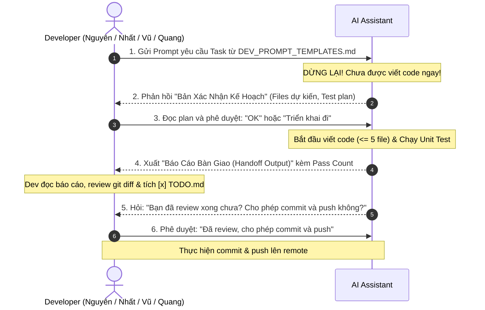

# 📘 HƯỚNG DẪN PHÁT TRIỂN DỰ ÁN VỚI AI (AI DEVELOPMENT PLAYBOOK)
# Cẩm nang thực chiến dành cho 4 thành viên: Nguyên, Nhất, Vũ, Quang

> **Dành cho thành viên nhóm:** Đây là tài liệu hướng dẫn chi tiết từng bước cách làm việc với các công cụ AI (Cursor, Claude, Copilot, ChatGPT, Antigravity) theo **Giao thức Bắt tay 2 lượt (2-Way Handshake Protocol)**. Bạn là người làm chủ, AI chỉ được làm khi bạn cho phép và chỉ được commit khi bạn đã review xong.

---

## 🤝 GIAO THỨC BẮT TAY 2 LƯỢT (2-WAY HANDSHAKE PROTOCOL)

Để không bao giờ bị AI "làm bừa", toàn bộ quy trình tương tác giữa bạn và AI sẽ diễn ra theo đúng sơ đồ sau:



---

## 🔄 CHI TIẾT 6 BƯỚC THỰC HIỆN MỖI TASK

### 📍 Bước 1: Chọn Task & Tạo Branch riêng
- Mở file [`TODO.md`](file:///d:/5th%20semester/cloud_compting/fantasy_lineup/TODO.md), chọn 1 task chưa làm của mình (ví dụ `P1-NG02`).
- Tạo và checkout branch mới:
  ```bash
  git checkout main
  git pull origin main
  git checkout -b feature/P1-NG02-virtual-pitch
  ```

---

### 💬 Bước 2: Gửi Prompt cho AI (Pre-execution Prompting)
- Mở file [`DEV_PROMPT_TEMPLATES.md`](file:///d:/5th%20semester/cloud_compting/fantasy_lineup/DEV_PROMPT_TEMPLATES.md), copy đoạn prompt của task đó và gửi cho AI.

---

### ✋ Bước 3: AI Xác nhận Kế hoạch & Chờ bạn duyệt (Lượt bắt tay số 1)
AI **bắt buộc** phải dừng lại và trả về bản xác nhận dạng:
```markdown
### 🎯 XÁC NHẬN KẾ HOẠCH TRIỂN KHAI TASK: [P1-NG02] - Xây dựng Virtual Pitch
- **Developer phụ trách:** Nguyên
- **Git Branch:** feature/P1-NG02-virtual-pitch
- **Dự kiến tạo mới:** 2/5 file (`VirtualPitch.tsx`, `VirtualPitch.test.tsx`).
- **Kế hoạch Unit Test:** 3 test cases (render 11 chính, render 4 bench, click chọn Captain).

👉 Bạn có đồng ý cho phép tôi bắt đầu triển khai kế hoạch này không? (Gõ 'OK' hoặc 'Triển khai' để bắt đầu).
```

👉 **Hành động của bạn:**
- Đọc lướt qua xem AI hiểu có đúng yêu cầu không, số file có $\le 5$ không.
- Nếu đồng ý, bạn chỉ cần gõ: **`OK`** hoặc **`Triển khai đi`**.
- Nếu thấy chưa đúng ý, bạn sửa lại ngay: *"Bổ sung thêm test case cho Captain nhé"* rồi mới gõ `OK`.

---

### 🧪 Bước 4: AI Viết Code & Tự Động Chạy Unit Test
Sau khi bạn gõ `OK`, AI mới bắt đầu:
1. Tạo tối đa 5 file mới.
2. Viết file test tương ứng.
3. Chạy lệnh test thực tế (`pytest` hoặc `npm test`) ngay trong terminal.
4. Đảm bảo 100% test cases pass (ví dụ: `Passed 4/4 test cases (100%)`).

---

### 📋 Bước 5: AI Xuất Handoff Output & Bàn giao cho bạn (Lượt bắt tay số 2)
AI sẽ xuất ra bản **Báo Cáo Bàn Giao Nghiệm Thu (Handoff Output)**:
```markdown
### 📋 BÁO CÁO BÀN GIAO NGHIỆM THU (HANDOFF OUTPUT): [P1-NG02]
- **Trạng thái:** ĐÃ HOÀN THÀNH & PASS TEST
- **Số file mới:** 2/5 files
- **Bằng chứng Unit Test:** Passed 4/4 test cases (100%)
...
#### Checklist dành cho Developer:
- [ ] Mở file TODO.md và tích [x] vào task [P1-NG02].
- [ ] Review diff code qua lệnh git diff.

💬 XÁC NHẬN COMMIT & PUSH:
"Bạn đã review xong toàn bộ thay đổi chưa? Nếu mọi thứ đã đạt yêu cầu, vui lòng gõ 'Cho phép commit' để tiến hành commit và push lên remote repo."
```

👉 **Hành động của bạn:**
1. Mở terminal gõ `git diff` hoặc xem diff trên giao diện IDE (Cursor / VS Code).
2. Kiểm tra nhanh:
   - [x] Không có hardcode password hay AWS secret.
   - [x] Không có cài đặt thư viện lạ.
3. Mở file **[`TODO.md`](file:///d:/5th%20semester/cloud_compting/fantasy_lineup/TODO.md)**, tìm task của mình và đổi từ `[ ]` thành **`[x]`**.

---

### 🚀 Bước 6: Phê duyệt Commit & Push lên Remote
Sau khi bạn đã hoàn thành việc review và tích `[x]`, bạn phản hồi lại cho AI:
> **`Đã review xong, cho phép commit và push`**

Lúc này, AI sẽ cung cấp (hoặc thực hiện) chính xác các lệnh Git sau:
```bash
git add .
git commit -m "feat(frontend): [P1-NG02] build virtual pitch component and tests"
git push origin feature/P1-NG02-virtual-pitch
```

---

## 🎯 BẢNG TÓM TẮT LỆNH GIAO TIẾP VỚI AI

| Giai đoạn | Bạn nói gì với AI? | AI sẽ phản ứng thế nào? |
| :--- | :--- | :--- |
| **Bắt đầu task** | Dán prompt từ `DEV_PROMPT_TEMPLATES.md` | Xuất Bản Kế Hoạch Xác Nhận, **dừng lại không code ngay**. |
| **Duyệt kế hoạch** | `OK` hoặc `Triển khai đi` | Bắt đầu code, tạo file test, chạy unit test. |
| **Nhận bàn giao** | Đọc Handoff Output của AI, kiểm tra git diff, tích `[x]` vào `TODO.md` | Chờ bạn review xong. |
| **Cho phép commit** | `Đã review xong, cho phép commit và push` | Thực hiện commit và push lên nhánh `feature/...`. |
| **Yêu cầu sửa** | `Test case X chưa đúng, sửa lại cho tôi chỗ Y` | Sửa lại code và chạy lại test cho đến khi pass 100%. |

---

*Chúc cả nhóm Nguyên, Nhất, Vũ, Quang làm chủ hoàn toàn AI và đẩy nhanh tiến độ dự án an toàn, chất lượng!*
