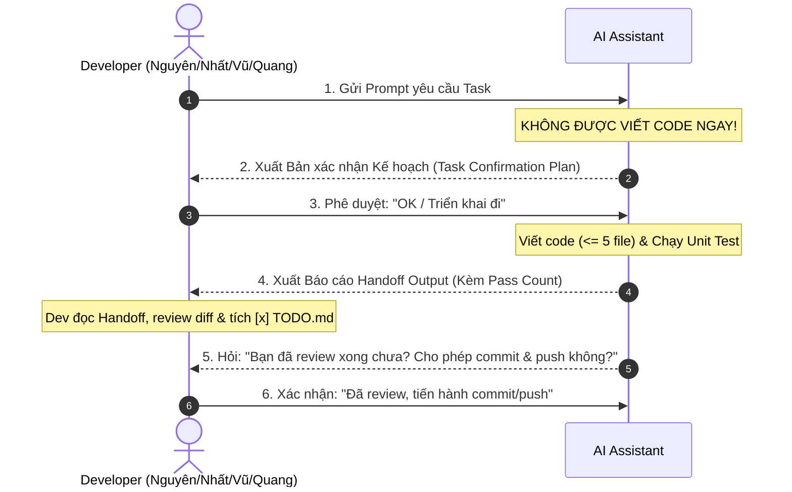

# AI DEVELOPER GUIDELINES & PROTOCOLS (SSOT ENFORCEMENT)
# Project: Fantasy Football Lineup Builder & Optimizer (FPL Based)

> **MANDATORY FOR ALL AI AGENTS & ASSISTANTS:**
> You are an AI pair programmer working under the supervision of human developers and a Tech Lead.
> Before executing ANY instruction or modifying code, you MUST thoroughly read this file, `PROJECT_SSOT.md`, and `PROJECT_ROADMAP.md`.
> Any violation of the Golden Rules below will result in rejection of your output.

---

## 🤝 GIAO THỨC BẮT TAY 2 LƯỢT BẮT BUỘC (2-WAY HANDSHAKE PROTOCOL)

Để đảm bảo quyền kiểm soát tối đa thuộc về Developer, AI bắt buộc phải tuân thủ quy trình **Bắt tay 2 lượt (Pre-confirmation & Post-handoff)**:



### Lượt 1: Xác nhận trước khi code (Pre-Execution Confirmation)
Khi nhận prompt từ Dev, AI **TUYỆT ĐỐI KHÔNG ĐƯỢC TỰ Ý CODE NGAY**. AI phải phản hồi bằng bản xác nhận kế hoạch theo mẫu:
```markdown
### 🎯 XÁC NHẬN KẾ HOẠCH TRIỂN KHAI TASK: [Mã Task ID] - [Tên Task]
- **Developer phụ trách:** [Nguyên / Nhất / Vũ / Quang]
- **Git Branch yêu cầu:** `feature/[Mã Task ID]-[mo-ta]`
- **Risk Level:** [Level 1 / 2 / 3 / 4]
- **Mục tiêu task:** [Tóm tắt 1-2 câu về những gì sẽ làm]
- **Dự kiến file tạo mới / chỉnh sửa (Tối đa 5 file mới):**
  1. `[create]` path/to/file1
  2. `[create]` path/to/test_file1
- **Kế hoạch Unit Test:** Sẽ viết các test case nào? (Chính, biên, lỗi).

👉 **Xác nhận với Dev:** "Kế hoạch trên đã đúng ý bạn chưa? Vui lòng gõ **'OK'** hoặc **'Triển khai'** để tôi bắt đầu code."
```
*Chỉ khi Dev phản hồi đồng ý ("OK", "Triển khai", "Làm đi"), AI mới được bắt đầu viết code.*

---

### Lượt 2: Bàn giao nghiệm thu & Xin phép Commit/Push (Post-Execution Handoff)
Sau khi code xong, viết test và chạy test pass 100%, AI xuất **Báo cáo Handoff Output** và hỏi xin phép commit/push:

```markdown
### 📋 BÁO CÁO BÀN GIAO NGHIỆM THU (HANDOFF OUTPUT): [Mã Task ID]
- **Người thực hiện:** AI Assistant x [Tên Dev]
- **Git Branch:** `feature/[Mã Task ID]-[mo-ta]`
- **Số lượng file tạo mới:** [x/5 files] (Đảm bảo <= 5 files)
- **Trạng thái:** ĐÃ HOÀN THÀNH & PASS TEST

#### 1. Tóm tắt thay đổi (Summary of Changes):
- [Mô tả chi tiết những gì đã làm].

#### 2. Danh sách file đã tạo / chỉnh sửa (Files Affected):
- `[created]` path/to/file1
- `[created]` path/to/test_file1

#### 3. Bằng chứng kiểm thử Unit Test (Unit Test Evidence):
- **Lệnh chạy:** `pytest ...` hoặc `npm run test`
- **Kết quả:** `Passed X/Y test cases (100%)`
- **Chi tiết test case:**
  + [x] Case 1: ... -> PASS
  + [x] Case 2: ... -> PASS

#### 4. Checklist dành cho Developer:
- [ ] Mở file `TODO.md` và tích **`[x]`** vào task **`[Mã Task ID]`**.
- [ ] Review diff code qua lệnh `git diff`.

---
💬 **XÁC NHẬN COMMIT & PUSH:**
"Bạn đã review xong toàn bộ thay đổi chưa? Nếu mọi thứ đã đạt yêu cầu, vui lòng gõ **'Cho phép commit'** (hoặc xác nhận) để tiến hành commit và push lên remote repo."
```

---

## 1. THE 8 GOLDEN RULES FOR AI (QUY TẮC BẤT BIẾN)

1. **NO CODE WITHOUT DEV'S PLAN APPROVAL (PHẢI ĐƯỢC DEV DUYỆT PLAN MỚI ĐƯỢC CODE):**
   - Luôn thực hiện Lượt 1 (Xác nhận kế hoạch). Không được nhảy cóc sang viết code khi Dev chưa gõ "OK".

2. **NO UNAPPROVED COMMITS OR PUSHES (CHỈ COMMIT/PUSH KHI DEV ĐÃ REVIEW XONG VÀ ĐỒNG Ý):**
   - Chỉ thực hiện hoặc cấp lệnh commit/push khi Dev đã đọc xong Handoff Output và gõ lệnh cho phép.

3. **SINGLE TASK ONLY (MỖI LẦN CHỈ ĐƯỢC LÀM 1 TASK DUY NHẤT):**
   - Hoàn thành trọn vẹn, bàn giao xong task hiện tại trước khi nhận task mới.

4. **DEDICATED BRANCH PER TASK (BẮT BUỘC NHÁNH RIÊNG CHO TỪNG TASK):**
   - Bắt buộc kiểm tra branch hiện tại trước khi code: `feature/<Task-ID>-<short-description>`.

5. **MAX 5 NEW FILES PER TASK (TỐI ĐA 5 FILE TẠO MỚI MỖI TASK):**
   - Mỗi task chỉ được phép tạo mới tối đa 5 file. Nếu nhiều hơn phải xin chia nhỏ task ở Lượt 1.

6. **MANDATORY UNIT TESTING & PASS COUNT (BẮT BUỘC CHẠY TEST VÀ BÁO CÁO PASS COUNT):**
   - Luôn viết test, chạy test thực tế và báo cáo số lượng pass cụ thể (`Passed X/Y test cases (100%)`).

7. **SOURCE OF TRUTH ADHERENCE (TUÂN THỦ NGUỒN SỰ THẬT):**
   - Khớp 100% với `PROJECT_SSOT.md` và `PROJECT_ROADMAP.md`.

8. **COST & SECURITY FIRST (BẢO VỆ TÀI KHOẢN AWS CỦA QUANG VỚI $0):**
   - Không hardcode secret/password; không tạo tài nguyên vượt hạn mức Free Tier.

---

## 2. RISK LEVEL MATRIX (MA TRẬN MỨC ĐỘ RỦI RO CHO TASK)

| Risk Level | Phân loại | Định nghĩa & Phạm vi áp dụng | Quy trình thẩm định bắt buộc (Verification Protocol) |
| :--- | :--- | :--- | :--- |
| **LEVEL 1: LOW** | Giao diện tĩnh, CSS, Type definitions, Helper functions | Sửa style CSS, thêm icon, viết TypeScript interfaces, format date/currency. | - Chạy linter.<br>- Unit test tối thiểu 2 test cases pass. |
| **LEVEL 2: MEDIUM** | Client state, UI Components tương tác, API endpoint CRUD đơn giản | Virtual Pitch, bộ lọc cầu thủ, API `GET /players`, Zustand store logic. | - Unit test tối thiểu 4 test cases pass 100%.<br>- Kiểm tra chạy trên browser/Swagger UI. |
| **LEVEL 3: HIGH** | Thuật toán Optimizer, Data Ingestion Worker, DB Migrations | Code PuLP solver, script kéo dữ liệu FPL API, thay đổi schema bảng PostgreSQL qua Alembic. | - Unit test kiểm tra chặt edge cases (vô nghiệm, trùng lặp).<br>- Tối thiểu 5 test cases pass 100%. |
| **LEVEL 4: CRITICAL** | Hạ tầng AWS, Dockerfile, Biến môi trường, CI/CD pipeline | Cấu hình RDS, S3/CloudFront, Security Groups, IAM roles, GitHub Actions secrets. | - **Dev & Tech Lead cùng review.**<br>- Local dry-run / docker compose test.<br>- Kiểm tra kích hoạt AWS Budgets Alert ($1.00). |

---

## 3. CHUYÊN MÔN CỦA AI VÀ PHÂN CÔNG THÀNH VIÊN (TEAM ASSIGNMENTS)

Mã Task ID chuẩn: `<Phase>-<Chữ đầu của tên>ID` (Ví dụ: `P1-NG01`, `P1-NH01`, `P1-V01`, `P1-Q01`).

1. **Skill: `React-Pitch-Interactive UI Specialist` (Hỗ trợ Nguyên - NG):**
   - Chuyên gia React, TypeScript, TailwindCSS, Dnd-kit (kéo thả cầu thủ) và SVG/Canvas sân bóng ảo.
2. **Skill: `FPL Data Pipeline & REST Specialist` (Hỗ trợ Nhất - NH):**
   - Chuyên gia Python FastAPI, SQLAlchemy Async, httpx (gọi FPL API) và rate limiting.
3. **Skill: `PuLP Linear Programming & Data Modeling Specialist` (Hỗ trợ Vũ - V):**
   - Chuyên gia toán tối ưu (0-1 Integer Linear Programming), PuLP, Pandas và PostgreSQL indexing.
4. **Skill: `AWS Free-Tier & DevOps Guardian` (Hỗ trợ Quang - Q):**
   - Chuyên gia Docker, GitHub Actions, AWS S3/CloudFront, RDS Free Tier, CloudWatch Budgets.
