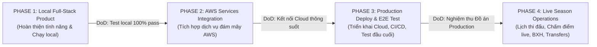
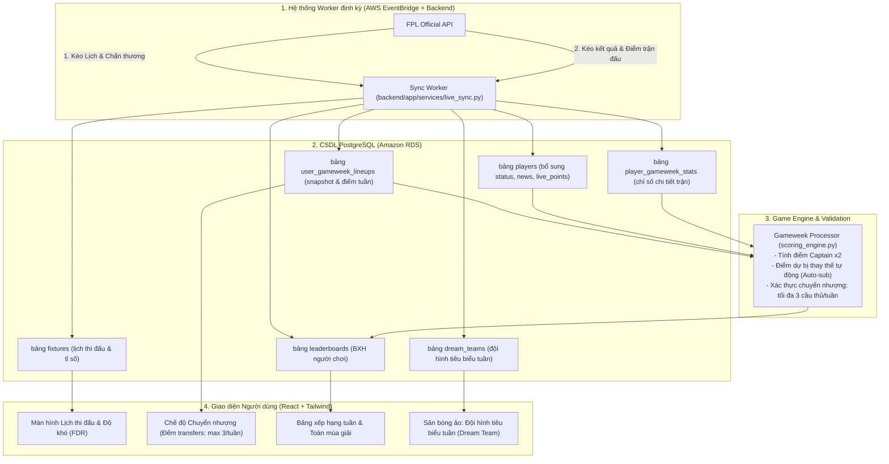

# KẾ HOẠCH TRIỂN KHAI DỰ ÁN 4 GIAI ĐOẠN (PROJECT ROADMAP)
# Fantasy Football Lineup Builder & Optimizer

> **Thành viên nhóm (4 người):**
> 1. **Nguyên (NG)** - Frontend & UI Lead
> 2. **Nhất (NH)** - Backend Core & FPL Data Sync Lead
> 3. **Vũ (V)** - Data & Algorithm Engineer (PuLP Optimizer & Comparison)
> 4. **Quang (Q)** - DevOps & Cloud Infrastructure Lead (Chủ tài khoản AWS)
>
> **Quy chuẩn mã Task (Task ID Syntax):** `<Phase>-<Chữ đầu của tên>ID`
> - Ví dụ: `P1-NG01` (Phase 1, Nguyên, task 01), `P1-Q01` (Phase 1, Quang, task 01).
> - Mọi commit, branch, pull request và prompt cho AI đều **bắt buộc** gắn kèm Task ID này.

---

## 📌 TỔNG QUAN 4 GIAI ĐOẠN

---

## 🚀 PHASE 1: TẠO SẢN PHẨM HOÀN CHỈNH & TEST TRÊN LOCAL
**Mục tiêu:** Xây dựng toàn bộ tính năng cốt lõi, chạy mượt mà trên môi trường Local thông qua `Docker Compose`. Cả nhóm test được toàn bộ luồng nghiệp vụ trên máy cá nhân mà không tốn chi phí.

### 📋 Danh sách Task Phase 1:

| Task ID | Người phụ trách (Owner) | Nội dung công việc (Task Description) | Risk Level | Output bàn giao (Deliverables) |
| :--- | :--- | :--- | :--- | :--- |
| **P1-NG01** | **Nguyên** *(Frontend)* | Khởi tạo base React + Vite + TypeScript + TailwindCSS + Shadcn/ui. Dựng layout điều hướng chung (Navbar, Header, Tabs). | **LEVEL 1** (Low) | Khung sườn Frontend chạy được trên `localhost:5173`. |
| **P1-NG02** | **Nguyên** *(Frontend)* | Xây dựng Sân bóng ảo (`VirtualPitch`): Hiển thị 11 cầu thủ chính theo sơ đồ và 4 cầu thủ dự bị trên Bench. Nút chọn Captain 'C' và Vice-Captain 'V'. | **LEVEL 2** (Medium) | Component sân bóng tương tác, responsive trên màn hình. |
| **P1-NG03** | **Nguyên** *(Frontend)* | Xây dựng Bảng danh sách & Bộ lọc cầu thủ (`PlayerTable`): Tìm kiếm theo tên, lọc theo vị trí (GKP/DEF/MID/FWD), CLB, sắp xếp theo giá và điểm số. | **LEVEL 2** (Medium) | Bảng cầu thủ hiển thị mượt, tìm kiếm tức thì. |
| **P1-NG04** | **Nguyên** *(Frontend)* | Quản lý trạng thái bằng Zustand (`lineupStore`): Validate realtime luật FPL (tổng giá $\rightarrow$\le$\rightarrow$ 100m, max 3 người/CLB, đủ 15 vị trí). Lưu/load trạng thái từ `localStorage`. | **LEVEL 2** (Medium) | Đội hình tự lưu lại khi F5 trang, cảnh báo khi vi phạm luật. |
| **P1-NG05** | **Nguyên** *(Frontend)* | Xây dựng Giao diện Điều khiển Optimizer & Màn hình So sánh (Side-by-side Compare View) với biểu đồ Radar (Recharts). | **LEVEL 2** (Medium) | Bảng điều khiển tối ưu và màn hình so sánh 2 đội hình trực quan. |
| **P1-NH01** | **Nhất** *(Backend)* | Khởi tạo base FastAPI, cấu hình CORS, Pydantic Settings, async SQLAlchemy kết nối PostgreSQL local. | **LEVEL 2** (Medium) | Server FastAPI chạy tại `localhost:8000`, có Swagger UI `/docs`. |
| **P1-NH02** | **Nhất** *(Backend)* | Viết service `fpl_sync.py`: Tự động gọi FPL API (`bootstrap-static`), trích xuất và Upsert dữ liệu 20 CLB và ~650 cầu thủ vào PostgreSQL. | **LEVEL 3** (High) | Dữ liệu FPL được đổ đầy đủ, giá cầu thủ chia 10 chuẩn xác (15.2m). |
| **P1-NH03** | **Nhất** *(Backend)* | Xây dựng REST API `GET /api/v1/players`: Hỗ trợ filter theo vị trí, team_id, khoảng giá, search tên, sort và phân trang. | **LEVEL 2** (Medium) | API trả về JSON chuẩn theo đúng hợp đồng trong `PROJECT_SSOT.md`. |
| **P1-NH04** | **Nhất** *(Backend)* | Xây dựng REST API `GET /api/v1/teams`: Lấy danh sách 20 đội bóng kèm các chỉ số sức mạnh công/thủ để hỗ trợ hiển thị. | **LEVEL 1** (Low) | Endpoint trả về danh sách 20 CLB Premier League. |
| **P1-V01** | **Vũ** *(Algo & Data)* | Thiết kế Schema PostgreSQL chi tiết cho các bảng `teams`, `players`, `player_history`, `shared_lineups` và thiết lập Alembic Migration. | **LEVEL 3** (High) | Script migration chạy tạo bảng và index chuẩn trong DB local. |
| **P1-V02** | **Vũ** *(Algo & Data)* | Xây dựng Module `optimizer_solver.py` bằng `PuLP`: Giải bài toán 0-1 Integer Linear Programming tối đa hóa điểm số thỏa mãn 100m ngân sách, max 3/team, 15 cầu thủ. | **LEVEL 3** (High) | Thuật toán giải ra nghiệm tối ưu trong thời gian < 100ms. |
| **P1-V03** | **Vũ** *(Algo & Data)* | Xây dựng REST API `POST /api/v1/optimizer/solve`: Nhận input (ngân sách, locked_player_ids, excluded_player_ids, sơ đồ) $\rightarrow$ gọi solver và trả về đội hình. | **LEVEL 3** (High) | Endpoint tối ưu hoạt động ổn định, xử lý các ca biên vô nghiệm. |
| **P1-V04** | **Vũ** *(Algo & Data)* | Xây dựng REST API `POST /api/v1/lineups/compare`: Nhận 2 lineup ID $\rightarrow$ tính toán chênh lệch ngân sách, điểm số, chỉ số công/thủ và danh sách cầu thủ khác biệt. | **LEVEL 2** (Medium) | Endpoint so sánh trả về dữ liệu phục vụ biểu đồ Radar của Nguyên. |
| **P1-Q01** | **Quang** *(DevOps)* | Viết `backend/Dockerfile` (Python 3.11-slim, cài PuLP & CBC solver) và `frontend/Dockerfile` (Vite multi-stage build). | **LEVEL 2** (Medium) | Dockerfile build gọn nhẹ, không dính cache thừa. |
| **P1-Q02** | **Quang** *(DevOps)* | Xây dựng `infra/docker-compose.yml` kết nối 3 service: `postgres`, `backend`, `frontend` kèm healthcheck và volume persist data. | **LEVEL 2** (Medium) | Cả nhóm gõ `docker compose up` là toàn bộ hệ thống khởi chạy đồng bộ. |
| **P1-Q03** | **Quang** *(DevOps)* | Viết kịch bản kiểm thử tích hợp tự động (Integration Test Script) kiểm tra kết nối giữa Frontend và Backend trên local. | **LEVEL 2** (Medium) | Script test chạy thành công, xác nhận các endpoint core hoạt động. |
| **P1-Q04** | **Quang** *(DevOps)* | Tạo tài liệu hướng dẫn chạy Local (`LOCAL_SETUP_GUIDE.md`) cho 3 thành viên còn lại clone repo về chạy thử. | **LEVEL 1** (Low) | Bản hướng dẫn chi tiết từng bước cài đặt và test local. |

### ✅ Tiêu chí nghiệm thu Phase 1 (Definition of Done - DoD):
- [ ] Gõ `docker compose up` chạy thành công không phát sinh lỗi.
- [ ] Dữ liệu cầu thủ FPL tự động cập nhật vào PostgreSQL local.
- [ ] Người dùng tự build được đội hình 15 người trên sân bóng ảo, tự lưu vào `localStorage`.
- [ ] Bấm nút "Optimize", hệ thống tự điền đội hình điểm cao nhất trong ngân sách quy định.
- [ ] Màn hình Compare so sánh được 2 đội hình bất kỳ.

---

## ☁️ PHASE 2: TÍCH HỢP SỬ DỤNG CÁC DỊCH VỤ CỦA AWS
**Mục tiêu:** Chuyển dịch hệ thống từ CSDL và lưu trữ local sang sử dụng các dịch vụ Cloud của AWS (AWS Free Tier, kiểm soát chi phí $\rightarrow$0).

### 📋 Danh sách Task Phase 2:

| Task ID | Người phụ trách (Owner) | Nội dung công việc (Task Description) | Risk Level | Output bàn giao (Deliverables) |
| :--- | :--- | :--- | :--- | :--- |
| **P2-NG01** | **Nguyên** *(Frontend)* | Tích hợp tính năng tạo Share Link: Gọi API backend lưu snapshot đội hình lên Cloud và nhận lại mã share ngắn (short-code). | **LEVEL 2** (Medium) | Người dùng có thể copy link chia sẻ đội hình cho bạn bè xem. |
| **P2-NG02** | **Nguyên** *(Frontend)* | Xây dựng màn hình xem đội hình qua link chia sẻ (`/share/:code`) - chế độ Read-only. | **LEVEL 2** (Medium) | Xem được đội hình người khác chia sẻ bằng link công khai. |
| **P2-NG03** | **Nguyên** *(Frontend)* | Cấu hình file môi trường `.env.production` để frontend sẵn sàng trỏ API về domain Cloud. | **LEVEL 1** (Low) | Config linh hoạt giữa môi trường local và cloud. |
| **P2-NH01** | **Nhất** *(Backend)* | Chuyển đổi chuỗi kết nối Database sang **Amazon RDS PostgreSQL** thông qua biến môi trường an toàn. | **LEVEL 3** (High) | Backend kết nối thông suốt với RDS Cloud. |
| **P2-NH02** | **Nhất** *(Backend)* | Xây dựng REST API `POST /api/v1/lineups/share` và `GET /api/v1/lineups/share/:code` để lưu/đọc snapshot đội hình từ RDS. | **LEVEL 2** (Medium) | API lưu và đọc đội hình chia sẻ hoạt động ổn định. |
| **P2-NH03** | **Nhất** *(Backend)* | Thiết lập Cron job / Background worker định kỳ tự động kích hoạt FPL data sync trên cloud mỗi khi có Gameweek mới. | **LEVEL 3** (High) | Dữ liệu cầu thủ trên RDS luôn mới nhất mà không cần trigger bằng tay. |
| **P2-V01** | **Vũ** *(Algo & Data)* | Chạy script migration toàn bộ Schema lên **Amazon RDS PostgreSQL** (bao gồm cả bảng `shared_lineups`). | **LEVEL 3** (High) | CSDL trên RDS có cấu trúc y hệt local kèm đầy đủ indexes. |
| **P2-V02** | **Vũ** *(Algo & Data)* | Cấu hình và tinh chỉnh Connection Pool (SQLAlchemy pool_size, max_overflow) tối ưu riêng cho instance `db.t4g.micro` để không bị nghẽn RAM. | **LEVEL 3** (High) | DB hoạt động mượt mà, không bị rơi vào trạng thái Connection Exhausted. |
| **P2-V03** | **Vũ** *(Algo & Data)* | Nghiên cứu và bổ sung thêm trọng số độ khó trận đấu (FDR - Fixture Difficulty) vào công thức tính điểm dự kiến (xP) của Optimizer. | **LEVEL 2** (Medium) | Đội hình gợi ý thông minh hơn (ưu tiên cầu thủ gặp đối thủ yếu ở vòng tới). |
| **P2-Q01** | **Quang** *(DevOps)* | Khởi tạo instance **Amazon RDS PostgreSQL (db.t4g.micro)** trên tài khoản AWS của Quang, Single-AZ, dung lượng 20GB gp3 (Free Tier). | **LEVEL 4** (Critical) | RDS PostgreSQL sẵn sàng kết nối. |
| **P2-Q02** | **Quang** *(DevOps)* | Cấu hình **Security Group** chặt chẽ: Chỉ mở port 5432 cho IP nhóm dev hoặc Security Group của Backend, không mở public `0.0.0.0/0`. | **LEVEL 4** (Critical) | DB được bảo vệ an toàn trước các cuộc quét bot trên Internet. |
| **P2-Q03** | **Quang** *(DevOps)* | **BẮT BUỘC:** Kích hoạt **AWS Budgets Alert** mức **$\rightarrow$1.00** trên tài khoản của Quang và gửi email cảnh báo tự động về hòm thư. | **LEVEL 4** (Critical) | Chặn đứng hoàn toàn nguy cơ bị trừ tiền ngoài ý muốn trên thẻ cá nhân. |
| **P2-Q04** | **Quang** *(DevOps)* | Khởi tạo **AWS S3 Bucket** cấu hình static hosting và chính sách truy cập an toàn. | **LEVEL 3** (High) | S3 bucket sẵn sàng nhận source build từ frontend. |

### ✅ Tiêu chí nghiệm thu Phase 2 (Definition of Done - DoD):
- [ ] Database đã chuyển từ Docker local lên Amazon RDS PostgreSQL.
- [ ] Backend kết nối và query RDS thông suốt với độ trễ thấp.
- [ ] AWS Budgets Alert đã được kích hoạt thành công (có email xác nhận).

---

## 🌐 PHASE 3: DEPLOY & TEST ĐẦU CUỐI (END-TO-END)
**Mục tiêu:** Đưa toàn bộ sản phẩm lên môi trường Internet thực tế, xây dựng luồng tự động hóa CI/CD, thực hiện kiểm thử tải và kiểm thử luồng người dùng hoàn chỉnh phục vụ báo cáo/demo.

### 📋 Danh sách Task Phase 3:

| Task ID | Người phụ trách (Owner) | Nội dung công việc (Task Description) | Risk Level | Output bàn giao (Deliverables) |
| :--- | :--- | :--- | :--- | :--- |
| **P3-NG01** | **Nguyên** *(Frontend)* | Tối ưu hóa hiệu năng Frontend: Code splitting, Lazy load Recharts/Pitch, giảm bundle size xuống < 500KB. | **LEVEL 2** (Medium) | Tốc độ load trang dưới 2 giây trên mạng 4G/Wifi. |
| **P3-NG02** | **Nguyên** *(Frontend)* | Hoàn thiện trải nghiệm responsive trên Mobile & Tablet: Tự động co giãn sân bóng ảo, drawer cho danh sách cầu thủ. | **LEVEL 2** (Medium) | Trải nghiệm mượt mà trên cả điện thoại di động và máy tính. |
| **P3-NG03** | **Nguyên** *(Frontend)* | Thực hiện User Acceptance Testing (UAT): Rà soát toàn bộ UI states (Loading skeleton, Error boundary, Toast thông báo). | **LEVEL 1** (Low) | Giao diện chỉn chu, chuyên nghiệp, không lỗi vặt. |
| **P3-NH01** | **Nhất** *(Backend)* | Cấu hình Structured Logging và tích hợp đẩy log lên AWS CloudWatch để theo dõi lỗi hệ thống production. | **LEVEL 2** (Medium) | Log hệ thống rõ ràng, dễ truy vết khi có lỗi 500. |
| **P3-NH02** | **Nhất** *(Backend)* | Tích hợp Rate Limiting (FastAPI-Limiter / SlowAPI) cho các endpoint core để ngăn chặn spam request vào backend. | **LEVEL 2** (Medium) | Bảo vệ backend không bị quá tải. |
| **P3-NH03** | **Nhất** *(Backend)* | Viết bộ kịch bản kiểm thử API đầu cuối (End-to-End API Test Suite) chạy tự động bằng Pytest. | **LEVEL 2** (Medium) | Toàn bộ 100% test cases API pass thành công. |
| **P3-V01** | **Vũ** *(Algo & Data)* | Stress test thuật toán Optimizer: Đo đạc thời gian giải khi có 20-50 request đồng thời và tối ưu thuật toán nếu phát hiện nghẽn. | **LEVEL 3** (High) | Optimizer giữ vững độ trễ < 200ms dưới tải trung bình. |
| **P3-V02** | **Vũ** *(Algo & Data)* | Xây dựng cơ chế In-Memory Cache (hoặc Redis) lưu kết quả của các tổ hợp optimize phổ biến (giảm tải cho solver). | **LEVEL 3** (High) | Các request trùng lặp trả về ngay lập tức trong 5ms. |
| **P3-V03** | **Vũ** *(Algo & Data)* | Chuẩn bị bộ dữ liệu mẫu (Sample Data) và kịch bản demo so sánh đội hình ấn tượng cho buổi nghiệm thu đồ án. | **LEVEL 1** (Low) | Kịch bản demo mạch lạc, số liệu bóng đá thuyết phục. |
| **P3-Q01** | **Quang** *(DevOps)* | Triển khai Frontend lên **AWS S3 + AWS CloudFront** (cấu hình SSL HTTPS miễn phí, CDN phân phối toàn cầu). | **LEVEL 4** (Critical) | Website truy cập công khai qua link CloudFront HTTPS. |
| **P3-Q02** | **Quang** *(DevOps)* | Đóng gói và triển khai Backend FastAPI lên **AWS App Runner** (hoặc EC2 t4g.small chạy Docker Compose). | **LEVEL 4** (Critical) | Backend production online 24/7, tự kết nối RDS. |
| **P3-Q03** | **Quang** *(DevOps)* | Xây dựng pipeline **GitHub Actions CI/CD**: Khi push vào nhánh `main` $\rightarrow$ Tự động Lint $\rightarrow$ Test $\rightarrow$ Build $\rightarrow$ Deploy lên AWS của Quang. | **LEVEL 4** (Critical) | Quy trình release tự động 100%, không cần deploy thủ công. |
| **P3-Q04** | **Quang** *(DevOps)* | Kiểm tra hóa đơn AWS Billing, đối soát chi phí $\rightarrow$0.00 và viết báo cáo kiến trúc triển khai Cloud cho đồ án. | **LEVEL 1** (Low) | Báo cáo kiến trúc AWS kèm bằng chứng chi phí nằm trọn trong Free Tier. |

### ✅ Tiêu chí nghiệm thu Phase 3 (Definition of Done - DoD):
- [ ] Website truy cập công khai qua domain CloudFront / HTTPS ổn định.
- [ ] Luồng người dùng hoàn chỉnh: Vào web $\rightarrow$ Xem stats cầu thủ $\rightarrow$ Tự xếp đội hình hoặc bấm Auto-Optimize $\rightarrow$ So sánh đội hình $\rightarrow$ Lưu & Chia sẻ link thành công.
- [ ] GitHub Actions tự động build và deploy khi có commit mới vào `main`.
- [ ] Chi phí tài khoản AWS hiển thị **$\rightarrow$0.00** (nằm trọn trong Free Tier).
- [ ] Đầy đủ slide báo cáo kiến trúc và kịch bản demo cho buổi nghiệm thu đồ án.

---

## 🏆 PHASE 4: VẬN HÀNH MÙA GIẢI & GAMIFICATION (LIVE SEASON OPERATIONS)
**Mục tiêu:** Đưa trò chơi vào vận hành mùa giải Ngoại hạng Anh trực tiếp: cập nhật lịch thi đấu 38 vòng, chấm điểm live cầu thủ sau trận đấu, quản lý chấn thương/treo giò, bảng xếp hạng người chơi (Leaderboard), đội hình tiêu biểu tuần (Dream Team) và luật giới hạn chuyển nhượng tối đa 3 cầu thủ/tuần.

### 🏗️ KIẾN TRÚC DỮ LIỆU & LUỒNG VẬN HÀNH (DATABASE ARCHITECTURE)

#### 📊 Chi tiết Thiết kế Các Bảng CSDL (Schema Specification):
1. **`fixtures`**: Lưu trữ toàn bộ 380 trận đấu trong mùa.
   - Các cột: `id` (PK), `gameweek` (1-38), `team_h` (FK `teams.id`), `team_a` (FK `teams.id`), `team_h_score`, `team_a_score`, `kickoff_time`, `finished` (boolean).
2. **`players` (Bổ sung thêm các trường y tế & live)**:
   - Các cột mới: `status` ('a': available, 'd': doubtful, 'i': injured, 's': suspended), `news` (text mô tả chấn thương), `chance_of_playing_next_round` (0, 25, 50, 75, 100), `live_points`.
3. **`player_gameweek_stats`**: Lưu thống kê chi tiết của cầu thủ trong từng vòng đấu.
   - Các cột: `id` (PK), `player_id` (FK), `fixture_id` (FK), `gameweek`, `minutes`, `goals`, `assists`, `clean_sheets`, `goals_conceded`, `yellow_cards`, `red_cards`, `saves`, `bonus_points`, `total_points`.
4. **`user_gameweek_lineups`**: Lưu snapshot đội hình của từng người chơi theo từng vòng.
   - Các cột: `id` (PK), `user_id`, `gameweek`, `starting_player_ids` (JSONB), `bench_player_ids` (JSONB), `captain_id`, `vice_captain_id`, `transfers_used` (int <= 3), `is_locked` (boolean), `gameweek_points` (int).
5. **`leaderboards`**: Bảng xếp hạng người chơi.
   - Các cột: `id` (PK), `user_id`, `lineup_name`, `gameweek`, `gw_points`, `total_points`, `overall_rank`.
6. **`dream_teams`**: Đội hình tiêu biểu của từng vòng đấu FPL.
   - Các cột: `id` (PK), `gameweek`, `top_player_ids` (JSONB), `total_points`.

---

### 📋 Danh sách Task Phase 4:

| Task ID | Người phụ trách (Owner) | Nội dung công việc (Task Description) | Risk Level | Output bàn giao (Deliverables) |
| :--- | :--- | :--- | :--- | :--- |
| **P4-NG01** | **Nguyên** *(Frontend)* | Xây dựng Màn hình Lịch thi đấu các tuần & Độ khó trận đấu (`FixturesView`): Hiển thị lịch 38 vòng đấu, tỉ số thực tế và huy hiệu độ khó trận đấu FDR (1-5). | **LEVEL 2** (Medium) | Giao diện lịch thi đấu trực quan, chọn lọc theo từng Gameweek. |
| **P4-NG02** | **Nguyên** *(Frontend)* | Hiển thị Huy hiệu Trạng thái Chấn thương & Treo giò (`PlayerStatusBadge`): Cờ đỏ 🚑 (Nghỉ/0%), cờ vàng ⚠️ (Nghi ngờ 25%-75%), cờ đỏ 🟥 (Treo giò) trên VirtualPitch và PlayerTable. | **LEVEL 2** (Medium) | Badge y tế kèm tooltip hiển thị chi tiết lý do chấn thương. |
| **P4-NG03** | **Nguyên** *(Frontend)* | Xây dựng Giao diện Bảng xếp hạng Người chơi (`LeaderboardView`) & Sân bóng vinh danh Đội hình tiêu biểu tuần (Dream Team). | **LEVEL 2** (Medium) | Màn hình BXH phân hạng Top 1-2-3 và modal sân cỏ Dream Team. |
| **P4-NG04** | **Nguyên** *(Frontend)* | Xây dựng Giao diện Luật Chuyển nhượng tuần: Bộ đếm lượt đổi người (tối đa 3 transfers/tuần), đồng hồ đếm ngược Deadline, modal chốt đội hình tuần. | **LEVEL 2** (Medium) | Bộ điều khiển chuyển nhượng an toàn, chặn thao tác quá 3 lượt. |
| **P4-NH01** | **Nhất** *(Backend)* | Xây dựng Worker `live_sync.py`: Tự động cào Lịch thi đấu 38 vòng (`/api/fixtures/`) & Trạng thái chấn thương/treo giò (`/api/bootstrap-static/`) lưu vào PostgreSQL. | **LEVEL 3** (High) | Lịch thi đấu và danh sách chấn thương luôn cập nhật mới nhất. |
| **P4-NH02** | **Nhất** *(Backend)* | Xây dựng Worker `gameweek_sync.py`: Cào Điểm trực tiếp sau trận (`/api/event/{gw}/live/`) và Đội hình tiêu biểu (`/api/dream-team/{gw}/`) lưu vào DB. | **LEVEL 3** (High) | Thống kê bàn thắng, kiến tạo, sạch lưới, điểm BPS được đồng bộ chuẩn xác. |
| **P4-NH03** | **Nhất** *(Backend)* | Xây dựng REST API `GET /api/v1/fixtures` & `GET /api/v1/dream-team/{gw}`: Cung cấp lịch thi đấu và 11 cầu thủ xuất sắc nhất vòng. | **LEVEL 2** (Medium) | Endpoint trả về JSON chuẩn theo từng Gameweek. |
| **P4-NH04** | **Nhất** *(Backend)* | Xây dựng REST API `GET /api/v1/leaderboard` & `POST /api/v1/transfers/confirm`: Trả về BXH người chơi và thực thi validation chặn chuyển nhượng > 3 cầu thủ. | **LEVEL 3** (High) | Hệ thống quản lý BXH và chốt chuyển nhượng vòng đấu hoạt động ổn định. |
| **P4-V01** | **Vũ** *(Algo & Data)* | Thiết kế Schema Migration Alembic cho các bảng: `fixtures`, `player_gameweek_stats`, `user_gameweek_lineups`, `dream_teams`. | **LEVEL 3** (High) | Script Alembic migration chạy mượt mà, tạo đầy đủ quan hệ và indexes. |
| **P4-V02** | **Vũ** *(Algo & Data)* | Xây dựng Game Engine tính điểm tự động (`scoring_engine.py`): Điểm Captain x2, cơ chế Auto-sub thay thế cầu thủ không thi đấu từ hàng ghế dự bị. | **LEVEL 3** (High) | Bộ tính điểm tuần tự động, chuẩn xác theo luật FPL chính thức. |
| **P4-V03** | **Vũ** *(Algo & Data)* | Nâng cấp PuLP Optimizer: Tự động loại bỏ cầu thủ chấn thương/treo giò và xây dựng chế độ gợi ý 3 lượt Chuyển nhượng Tối ưu nhất (Transfer Optimizer). | **LEVEL 3** (High) | Gợi ý 3 lượt thay cầu thủ mang lại điểm kỳ vọng (xP) cao nhất. |
| **P4-Q01** | **Quang** *(DevOps)* | Thiết lập **AWS EventBridge Scheduler**: Tự động kích hoạt sync lịch thi đấu trước trận và kích hoạt sync điểm số sau khi trận đấu kết thúc. | **LEVEL 3** (High) | Quy trình sync dữ liệu mùa giải tự động 100% trên Cloud. |
| **P4-Q02** | **Quang** *(DevOps)* | Tích hợp Redis Caching cho Bảng xếp hạng và Lịch thi đấu để chịu tải hàng ngàn request cùng lúc mà không làm quá tải RDS. | **LEVEL 3** (High) | Tốc độ phản hồi BXH < 20ms ngay cả khi traffic tăng đột biến. |
| **P4-Q03** | **Quang** *(DevOps)* | Viết kịch bản kiểm thử tích hợp vòng đời tuần thi đấu (Gameweek Lifecycle Test): Chuyển nhượng 3 người $\rightarrow$
ightarrow$\rightarrow$ Khóa deadline $\rightarrow$
ightarrow$\rightarrow$ Tính điểm $\rightarrow$
ightarrow$\rightarrow$ Cập nhật BXH. | **LEVEL 2** (Medium) | Kịch bản test tự động xác nhận toàn bộ luồng game vận hành trơn tru. |

### ✅ Tiêu chí nghiệm thu Phase 4 (Definition of Done - DoD):
- [ ] Lịch thi đấu hiển thị đầy đủ 38 vòng và tự động cập nhật tỉ số thực tế.
- [ ] Cầu thủ chấn thương/treo giò được hiển thị badge cảnh báo rõ ràng; Optimizer không chọn cầu thủ chấn thương.
- [ ] Điểm số đội hình người chơi được tính toán tự động sau trận và xếp hạng trên Leaderboard.
- [ ] Hiển thị Sân bóng vinh danh Đội hình tiêu biểu của vòng (Dream Team).
- [ ] Luật chuyển nhượng tối đa 3 cầu thủ/tuần được thực thi nghiêm ngặt cả trên giao diện lẫn Backend API.
- [ ] 100% unit tests và integration tests pass hoàn toàn.
