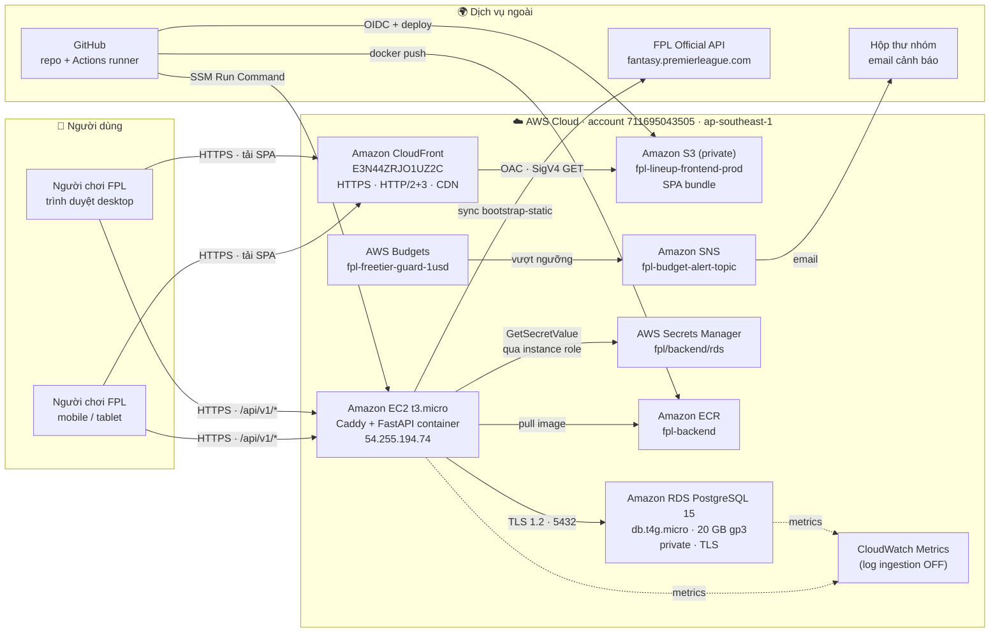
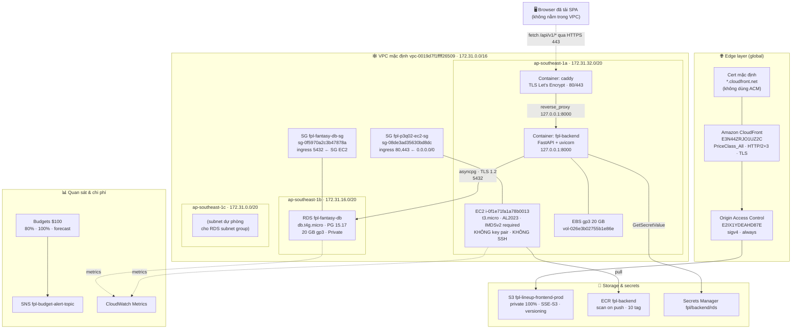
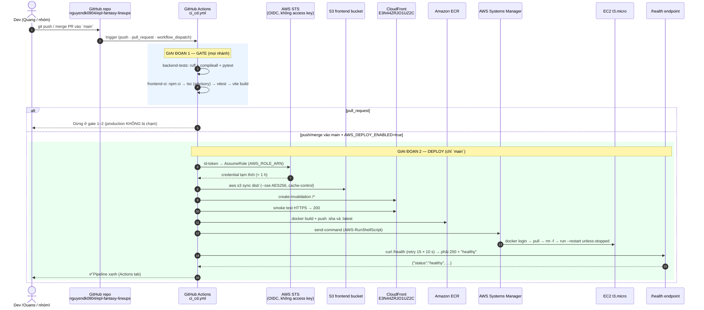
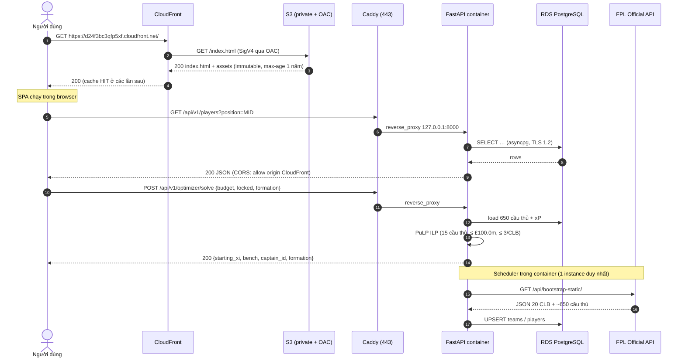
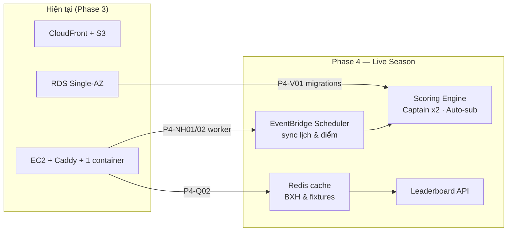

# ☁️ KIẾN TRÚC ĐÁM MÂY AWS — CLOUD ARCHITECTURE DOCUMENT
# Fantasy Football Lineup Builder & Optimizer (FPL Based)

> **Task:** `P3-Q04` · **Owner:** Quang (DevOps & AWS Lead) · **Branch:** `feature/P3-Q04-cloud-architecture-doc`
> **Tài liệu đồng hành:** [`COST_REPORT.md`](COST_REPORT.md) — đối soát chi phí `$0.00` & unit economics
> **Nguồn chuẩn:** [`PROJECT_SSOT`](PROJECT_SSOT.md) · [`PROJECT_ROADMAP`](PROJECT_ROADMAP.md) · [`TODO`](TODO.md) · [`AI_GUIDELINES`](AI_GUIDELINES.md)
> **Trạng thái số liệu:** kiểm chứng trực tiếp trên AWS ngày **10/11/2026** (read-only API) — mọi ID/ARN trong tài liệu này là **giá trị thật**, không phải mẫu.

---

## 1. 🎯 THÔNG TIN HỆ THỐNG & TL;DR

| Hạng mục | Giá trị |
| :--- | :--- |
| **Ứng dụng** | Xây & tối ưu đội hình Fantasy Premier League: 15 cầu thủ, ngân sách £100.0m, tối đa 3 cầu thủ/CLB, tối ưu bằng PuLP ILP |
| **Frontend** | React 18 + TypeScript + Vite + TailwindCSS + Zustand + TanStack Query + Recharts |
| **Backend** | Python 3.11 + FastAPI + SQLAlchemy 2.0 (async) + PuLP |
| **Database** | PostgreSQL **15.17** trên Amazon RDS |
| **AWS Account / Region** | `711695043505` · **`ap-southeast-1`** (Singapore) — dịch vụ global: CloudFront, Budgets, Cost Explorer |
| **URL công khai (Frontend)** | **https://d24f3bc3qfp5xf.cloudfront.net** |
| **URL công khai (Backend)** | **https://54.255.194.74.sslip.io** — health: `/health` |
| **Số tài nguyên đang chạy** | **8 dịch vụ AWS** (CloudFront · S3 · EC2 · ECR · RDS · Secrets Manager · SNS · Budgets) |
| **Chi phí thực trả** | **`$0.00`** (net) — gross `≈ $36.6/tháng` được credit AWS Free plan chi trả → xem [`COST_REPORT.md`](COST_REPORT.md) |

### 1.1. Ba câu chốt về kiến trúc

1. **Tách tĩnh/động (static-first):** toàn bộ SPA là file tĩnh trên **S3 private** + **CloudFront OAC** ⇒ không cần server phục vụ frontend, CDN lo TLS + cache toàn cầu.
2. **Một máy chủ backend duy nhất, có chủ đích:** EC2 `t3.micro` chạy **1 container** FastAPI sau **Caddy** (TLS tự động) ⇒ vừa đủ cho ~650 cầu thủ + solver, và **bắt buộc** để scheduler đồng bộ FPL không chạy trùng.
3. **Không có "tầng thừa":** không ALB, không NAT Gateway, không WAF, không ElastiCache ⇒ mỗi thành phần bị loại bỏ đều có lý do **chi phí Free-plan** được ghi rõ ở §7.2.

---

## 2. 🗺️ SƠ ĐỒ 1 — BỐI CẢNH HỆ THỐNG (SYSTEM CONTEXT)



> 🔎 **Đọc sơ đồ:** nét liền = luồng dữ liệu người dùng; nét đứt = quan sát/điều khiển.
> Frontend gọi API **trực tiếp qua HTTPS** sang EC2 (đường nét đứt `CF -.-> EC2`): CloudFront **không** làm proxy cho API ở phiên bản này — chi tiết & lý do ở **ADR-06** (§10).
> Endpoint API gốc được nhúng lúc build qua biến `VITE_API_BASE_URL` (*build-time*), không phải *runtime* — đổi URL backend ⇒ **phải rebuild frontend**.
> Endpoint API gốc được nhúng lúc build qua biến `VITE_API_BASE_URL` (*build-time*), không phải *runtime* — đổi URL backend ⇒ **phải rebuild frontend**.
> ⚠️ **Bundle đang chạy resolve API về chính domain CloudFront (`/api/v1`)** trong khi CloudFront **không có** origin `/api/*` ⇒ call API nhận `index.html` (HTML, 200) thay vì JSON. Đây là **gap I-1** — bằng chứng đầy đủ ở **§6.4**, xem §11.

---

## 3. 🏗️ SƠ ĐỒ 2 — KIẾN TRÚC TRIỂN KHAI & MẠNG (DEPLOYMENT TOPOLOGY)



### 3.1. Bảng thành phần & trách nhiệm

| Lớp | Thành phần | Vai trò | Cấu hình then chốt |
| :--- | :--- | :--- | :--- |
| **Edge** | CloudFront `E3N44ZRJO1UZ2C` | CDN + TLS + cache SPA | `PriceClass_All`, `http2and3`, SPA fallback **403/404 → `/index.html` (200, TTL 10 s)**, managed *CachingOptimized* + *SecurityHeaders* |
| **Edge** | OAC `E2IX1YDEAHD87E` | Ký SigV4 tới S3 **private** | `sigv4` / `always` / `s3` — **thay** cho Static Website Hosting (đã tắt có chủ đích) |
| **Storage** | S3 `fpl-lineup-frontend-prod` | Chứa bundle tĩnh | BPA **4/4 true**, `IsPublic=false`, SSE-S3 `AES256`, versioning `Enabled`, lifecycle dọn multipart/noncurrent |
| **Compute** | EC2 `i-0f1e71fa1a78b0013` | Chạy 2 container, 1 scheduler | `t3.micro`, **không** key pair, **không** mở 22 (vào bằng **SSM**), `IMDSv2 required`, instance profile `fpl-p3q02-ec2-profile` |
| **Compute** | Container `caddy` | Reverse proxy + TLS | Let's Encrypt qua `54.255.194.74.sslip.io`, HTTP→HTTPS redirect |
| **Compute** | Container `fpl-backend` | FastAPI (REST + solver) | `--restart unless-stopped`, bind `127.0.0.1:8000` (**không** expose ra ngoài), env từ `/opt/fpl/backend.env` |
| **Registry** | ECR `fpl-backend` | Nguồn image cho CI/CD | `scanOnPush=true`, tag `sha` + `latest` |
| **Data** | RDS `fpl-fantasy-db` | PostgreSQL 15.17 | `db.t4g.micro`, **Single-AZ** `ap-southeast-1b`, 20 GB `gp3`, `PubliclyAccessible=false`, backup retention **1 ngày** |
| **Secret** | Secrets Manager `fpl/backend/rds` | Mật khẩu DB | EC2 đọc bằng **instance role**, không nằm trong repo/ env file tĩnh |
| **Cost** | Budgets + SNS | Hàng rào chi phí | `$100` limit, ngưỡng **80 %**, **100 %**, **forecast 100 %** → email nhóm |

> 🔐 **Nguyên tắc "private by default":** cả S3 (bucket) và RDS (instance) đều **không** truy cập được từ Internet; đường vào duy nhất của người dùng là **CloudFront** (frontend) và **Caddy 443** (API).
> 🔎 **Không có NAT Gateway**: container gọi FPL API / ECR / Secrets Manager qua route mặc định của subnet công khai. NAT Gateway **tính phí theo giờ + theo GB** và **không** có hạn mức Always-Free ⇒ nếu thêm vào, chi phí gross sẽ tăng vọt và **rút ngắn thời gian sống của credit** (xem §7.2 và [`COST_REPORT.md`](COST_REPORT.md) §6.4).


---

## 4. 🔄 SƠ ĐỒ 3 — PIPELINE CI/CD (GITHUB ACTIONS → AWS, ZERO-TOUCH)



### 4.1. Chi tiết job & biến cấu hình

| Job | Chạy khi | Nội dung | Bảo vệ |
| :--- | :--- | :--- | :--- |
| `backend-tests` | mọi trigger | Gọi lại `test_backend.yml` (ruff + `compileall` + pytest) | Chặn code hỏng lên production |
| `frontend-ci` | mọi trigger | `npm ci` → `tsc` (advisory) → `vitest` → `vite build` → upload artifact | Chặn bundle lỗi |
| `deploy-frontend` | **chỉ `main`** | `s3 sync --sse AES256` + CloudFront invalidation + smoke HTTPS | `AWS_DEPLOY_ENABLED` (mặc định **false** = đóng băng deploy) |
| `deploy-backend` | **chỉ `main`** | `docker build` → ECR push → **SSM Run Command** restart container → `/health` smoke | Không SSH, không key tĩnh |

**Bất biến bảo mật của pipeline (không được nới):**

| # | Bất biến | Lý do |
| :-: | :--- | :--- |
| S1 | **Không long-lived AWS key** — dùng GitHub **OIDC** → IAM role (`id-token: write`) | Key tĩnh trong secrets là rủi ro rò rỉ cao nhất |
| S2 | Job deploy **gate** bằng `github.event_name != 'pull_request'` | PR từ fork **không** được chạm production |
| S3 | Mọi upload S3 kèm `--sse AES256` | Bucket policy có `DenyInsecureObjectUpload` |
| S4 | Pipeline **chỉ ship artifact**, không tạo/sửa hạ tầng | Tránh "CI/CD tự nâng instance" ⇒ bill bất ngờ |
| S5 | `concurrency` theo `ref`, run `main` **không** bị cancel giữa lúc deploy | Tránh nửa deploy |

> 📌 Biến repository cần có (đều có **default** trùng tài liệu `infra/aws/*.md`): `AWS_ROLE_ARN` *(secret)*, `AWS_DEPLOY_ENABLED`, `AWS_REGION`, `S3_BUCKET_NAME`, `CLOUDFRONT_DISTRIBUTION_ID`, `SITE_URL`, `ECR_REPOSITORY`, `EC2_INSTANCE_ID`, `API_HEALTH_URL`.

---

## 5. 🔁 SƠ ĐỒ 4 — VÒNG ĐỜI MỘT REQUEST & LUỒNG DỮ LIỆU FPL



### 5.1. Vì sao **chỉ 1 container** backend? (ràng buộc kiến trúc, không phải lựa chọn ngẫu nhiên)

| Lý do | Chi tiết |
| :--- | :--- |
| **Scheduler đồng bộ FPL** chạy trong process (`services/cron_scheduler.py`) | 2 container ⇒ **sync trùng**, ghi đè dữ liệu, tốn request tới FPL API |
| Rate limit dùng storage `memory://` (`P3-NH02`) | Nhiều process ⇒ mỗi process có counter riêng ⇒ **hạn mức bị nhân lên**, vô hiệu hoá bảo vệ |
| CPU/RAM `t3.micro` (2 vCPU burst / 1 GB) | 1 container FastAPI + solver đủ cho demo; scale-out cần **Redis dùng chung** + khoá distributed (Phase 4 — `P4-Q02`) |

> ⚠️ **Bất biến khi vận hành:** nếu buộc phải scale > 1 instance, **trước tiên** đặt `FPL_SYNC_ENABLED=false` cho tất cả container trừ một, và cấu hình `RATE_LIMIT_STORAGE_URI` trỏ Redis dùng chung.


---

## 6. 📋 INVENTORY TÀI NGUYÊN THẬT (KIỂM CHỨNG 10/11/2026)

### 6.1. Tài nguyên AWS đang tồn tại

| # | Dịch vụ | Định danh thật | Cấu hình | Vai trò |
| :-: | :--- | :--- | :--- | :--- |
| 1 | **CloudFront** | `E3N44ZRJO1UZ2C` · `d24f3bc3qfp5xf.cloudfront.net` | `Deployed`, `Enabled`, `PriceClass_All`, `HTTP2and3`, SPA fallback 403/404 | CDN + TLS cho SPA |
| 2 | **S3** | `fpl-lineup-frontend-prod` | BPA **4/4**, `IsPublic=false`, SSE-S3 `AES256`, versioning `Enabled` | Origin tĩnh private |
| 3 | **OAC** | `E2IX1YDEAHD87E` | `sigv4` / `always` / `s3` | Ký request CloudFront → S3 |
| 4 | **EC2** | `i-0f1e71fa1a78b0013` | `t3.micro`, AL2023, `54.255.194.74`, `subnet-0864901a67ce68e8f` (1a), **IMDSv2 required**, **không key pair** | Chạy Docker (Caddy + FastAPI) |
| 5 | **EBS** | `vol-026e3b02755b1e86e` | 20 GB `gp3`, `ap-southeast-1a`, `in-use` | Root volume EC2 |
| 6 | **ECR** | `fpl-backend` | `scanOnPush=true`, 10 tag (`latest` + `sha`) | Registry image backend |
| 7 | **RDS** | `fpl-fantasy-db` · `fpl-fantasy-db.cr0maoomq80d.ap-southeast-1.rds.amazonaws.com:5432` | `db.t4g.micro`, PG **15.17**, 20 GB `gp3`, Single-AZ `1b`, `PubliclyAccessible=false`, backup **1 ngày** | CSDL chính |
| 8 | **Secrets Manager** | `fpl/backend/rds` | rotation **off** | Mật khẩu DB |
| 9 | **SNS** | `fpl-budget-alert-topic` | 1 email subscription `Confirmed` | Kênh cảnh báo chi phí |
| 10 | **Budgets** | `fpl-freetier-guard-1usd` | `$100`/tháng, ngưỡng 80 % · 100 % · forecast 100 % | Hàng rào chi phí |
| 11 | **IAM** | `fpl-p3q02-ec2-profile` + role `fpl-p3q02-ec2-role` | `AmazonSSMManagedInstanceCore` + inline `SecretsManager` | EC2 không cần key/SSH |
| 12 | **Security Group** | `sg-08de3ad35630bd8dc` (`fpl-p3q02-ec2-sg`) | ingress **80, 443** ← `0.0.0.0/0` | Public entry của API |
| 13 | **Security Group** | `sg-0f5970a2c3b47878a` (`fpl-fantasy-db-sg`) | ingress **5432** ← `sg-08de…` *(+ CIDR dev `14.191.166.167/32` — drift)* | Bảo vệ RDS |
| 14 | **VPC / Subnets** | `vpc-0019d7f1ffff26509` (default) · `subnet-0864…1a` · `subnet-0065…1b` · `subnet-05dd…1c` | `172.31.0.0/16`, cả 3 subnet đều `MapPublicIpOnLaunch=true` | Mạng |

**Tài nguyên CỐ Ý KHÔNG tạo** (đã kiểm bằng API — trả về rỗng/không tồn tại): NAT Gateway · Application Load Balancer · WAF · Origin Shield · Elastic IP · CloudWatch Log Group · KMS CMK · Route 53 hosted zone · ACM certificate · ElastiCache · Lambda · App Runner.

### 6.2. Bằng chứng hệ thống **đang sống** (curl thật, 10/11/2026)

| Kiểm tra | Lệnh | Kết quả |
| :--- | :--- | :--- |
| Frontend qua CDN | `curl -o /dev/null -w '%{http_code} %{time_total}' https://d24f3bc3qfp5xf.cloudfront.net/` | **`200` · `0.553 s`** |
| Backend health | `curl https://54.255.194.74.sslip.io/health` | **`200`** `{"status":"healthy","service":"Fantasy Football Lineup Optimizer API","version":"1.0.0","environment":"production"}` |
| API nghiệp vụ | `curl -o /dev/null -w '%{http_code}' https://54.255.194.74.sslip.io/api/v1/players?limit=1` | **`200`** ⚠️ nhưng `total: 0` |
| CORS cho CloudFront | `curl -X OPTIONS -H 'Origin: https://d24f3bc3qfp5xf.cloudfront.net' …` | **`200`** · `Access-Control-Allow-Origin: https://d24f3bc3qfp5xf.cloudfront.net` |
| S3 nặc danh | truy cập trực tiếp bucket | **`403`** (đúng thiết kế private) |
| S3 public status | `get-bucket-policy-status` | `IsPublic: false` |
| OAC gắn distribution | `get-distribution-config` | `OriginAccessControlId = E2IX1YDEAHD87E` |

### 6.3. Trạng thái dữ liệu production (⚠️ quan trọng cho buổi demo)

```
GET /api/v1/teams                      → 200  []
GET /api/v1/players?limit=1            → 200  {"total": 0, "items": []}
```

> 🔴 **Database production đang TRỐNG** (0 CLB, 0 cầu thủ). `/health` **không** ping DB nên vẫn trả `healthy` — đúng như cảnh báo trong `infra/aws/app_runner_setup.md` §10 (*"`/health` 200 nhưng UI trống"*).
> ⇒ Trước khi demo/nghiệm thu **phải** nạp dữ liệu FPL thật vào RDS. Hai đường: (a) bật `FPL_SYNC_ENABLED=true` cho container và gọi endpoint sync, hoặc (b) chạy [`scripts/seed_demo_data.py`](../scripts/seed_demo_data.py) trỏ vào RDS. Đây là **gap I-2** ở §11 — **không thuộc phạm vi `P3-Q04`** (task tài liệu).

### 6.4. Gap I-1 — frontend gọi API vào **chính domain CloudFront** (⚠️ quan trọng cho đồ án)

> ✅ **Đính chính kỹ thuật (10/11/2026):** bản nháp đầu của tài liệu này kết luận *"bundle trỏ `http://localhost:8000`"* — **SAI**. Chuỗi đó là **hằng số fallback** `DEFAULT_LOCAL_BASE_URL` trong `apiClient.ts`, **luôn** có mặt trong bundle đã minify dù không được dùng. Chẩn đoán đúng ở dưới.

| Bằng chứng (đo thật) | Kết quả | Ý nghĩa |
| :--- | :--- | :--- |
| `frontend/.env.production` | `VITE_API_BASE_URL=/api/v1` | Build production nhúng **đường dẫn tương đối** `/api/v1` |
| `apiClient.ts` (`P2-NG03`) | path bắt đầu bằng `/` ⇒ trả `${window.location.origin}/api/v1` | Runtime resolve thành **`https://d24f3bc3qfp5xf.cloudfront.net/api/v1`** |
| `curl …/assets/index-N9E9CsZw.js \| grep -c '/api/v1'` | **3 lần** `/api/v1` *(và 1 lần `localhost:8000` = fallback chết)* | Bundle **đang dùng** đường dẫn tương đối, không dùng localhost |
| `aws cloudfront get-distribution-config --id E3N44ZRJO1UZ2C` | `Origins: [S3]` duy nhất · `CacheBehaviors: null` | **Không có** origin/behavior `/api/*` nào trỏ EC2 |
| `curl https://d24f3bc3qfp5xf.cloudfront.net/api/v1/teams` | **`200` · `content-type: text/html`** · body = `<!doctype html>…` | Request API bị **SPA fallback 403/404 → `/index.html`** nuốt mất ⇒ trả **HTML thay vì JSON** |
| Backend trực tiếp | `https://54.255.194.74.sslip.io/api/v1/teams` = `200` · CORS đã allow origin CloudFront | **Backend OK** — lỗi nằm ở **định tuyến phía client/CDN** |

> 🔴 **Hệ quả đúng:** web công khai **hiển thị** nhưng mọi call API nhận **`index.html`** ⇒ `JSON.parse` thất bại ⇒ danh sách cầu thủ/optimizer **không chạy**. (Không phải lỗi *mixed content* như bản nháp.)
> ✅ **Hai hướng sửa — chọn 1:**
> **(A) Trỏ thẳng về backend (khuyến nghị, khớp ADR-06):** set biến ở **bước build trong CI** (`.github/workflows/ci_cd.yml` — Vite ưu tiên biến môi trường của process hơn `.env.production`):
> ```yaml
> - name: Build production bundle (CloudFront root base)
>   env:
>     VITE_API_BASE_URL: ${{ vars.API_BASE_URL || 'https://54.255.194.74.sslip.io/api/v1' }}
>   run: npm run build -- --base=/
> ```
> **(B) Thêm origin `/api/*` trên CloudFront trỏ EC2** (same-origin, bỏ được CORS) — nhưng phải tạo **origin thứ 2** + behavior + đổi **ADR-06**; nặng hơn và rủi ro cache POST.
> ⚠️ Cả hai đều **Level 4** ⇒ Tech Lead review + **task riêng**; **không** thực hiện trong `P3-Q04`.


---

## 7. 🔐 MÔ HÌNH BẢO MẬT

### 7.1. Ma trận luồng mạng (ai được nói chuyện với ai)

| Từ ↓ / Đến → | Internet | CloudFront | EC2 :443 | EC2 :8000 | RDS :5432 | S3 | Secrets | SSM |
| :--- | :-: | :-: | :-: | :-: | :-: | :-: | :-: | :-: |
| **Người dùng (browser)** | — | ✅ HTTPS | ✅ HTTPS | ❌ | ❌ | ❌ | ❌ | ❌ |
| **CloudFront** | ✅ | — | ❌ | ❌ | ❌ | ✅ **SigV4 (OAC)** | ❌ | ❌ |
| **EC2 (container)** | ✅ (qua subnet public) | ❌ | — | ✅ localhost | ✅ **SG→SG** + TLS 1.2 | ✅ (CI) | ✅ `GetSecretValue` | ✅ agent |
| **GitHub Actions** | ✅ | ✅ API | ❌ *(chỉ qua SSM)* | ❌ | ❌ | ✅ `s3 sync` | ❌ | ✅ `send-command` |
| **RDS** | ❌ | ❌ | ❌ | ❌ | — | ❌ | ❌ | ❌ |

**Chi tiết Security Group (đo thật):**

| SG | Chiều | Port | Nguồn | Đánh giá |
| :--- | :--- | :-: | :--- | :--- |
| `fpl-p3q02-ec2-sg` | ingress | 80, 443 | `0.0.0.0/0` | ✅ Bắt buộc (Caddy phục vụ công khai) — **không** có 22 |
| `fpl-p3q02-ec2-sg` | egress | all | `0.0.0.0/0` | ✅ Cần để pull ECR / gọi FPL API |
| `fpl-fantasy-db-sg` | ingress | 5432 | **`sg-08de3ad35630bd8dc`** | ✅ Chuẩn **SG→SG** (không phụ thuộc IP) |
| `fpl-fantasy-db-sg` | ingress | 5432 | `14.191.166.167/32` | ⚠️ **Drift** — IP dev; RDS private nên chưa khai thác được, nên revoke |
| `launch-wizard-1` *(mồ côi)* | ingress | 22, 80, 443, 8080 | `0.0.0.0/0` | 🔴 **Không gắn tài nguyên nào** — nên xoá |

### 7.2. Kiểm soát bảo mật đã áp dụng & thứ đã **cố ý tắt**

| Hạng mục | Trạng thái | Ghi chú |
| :--- | :---: | :--- |
| IAM least-privilege cho EC2 | ✅ | Instance role chỉ `SSMManagedInstanceCore` + đọc **đúng 1 secret** |
| Không SSH / không key pair | ✅ | Vào máy bằng **SSM Session Manager** ⇒ không mở 22, không quản lý private key |
| IMDSv2 bắt buộc | ✅ | `HttpTokens=required` (chặn SSRF lấy credential) |
| Secret không nằm trong repo | ✅ | `.env` bị `.gitignore`; production đọc từ Secrets Manager |
| TLS end-to-end | ✅ | CloudFront → viewer: TLS 1.2/1.3 (*.cloudfront.net); browser → API: Let's Encrypt (`sslip.io`); API → RDS: TLS 1.2 |
| S3 private tuyệt đối | ✅ | BPA 4/4 + `IsPublic=false` + policy deny HTTP thường & deny upload thiếu SSE |
| Không long-lived AWS key trong CI | ✅ | GitHub **OIDC** → role tạm thời |
| Rate limiting API | ✅ | `P3-NH02` (mặc định `memory://`, 1 process) |
| **WAF** | ❌ **TẮT** | `$5/tháng` = 5× ngưỡng budget gốc `$1` ⇒ không dùng cho đồ án |
| **CloudFront access logging** | ❌ **TẮT** | Mỗi log = 1 S3 PUT; đã có CloudWatch metrics thay thế |
| **Origin Shield** | ❌ **TẮT** | Không cần với 1 origin, 1 region |
| **CloudWatch Logs ingestion** | ❌ **TẮT** | `CLOUDWATCH_LOGGING_ENABLED=false` ⇒ tránh phí ingestion; log nằm trong `docker logs` |
| **RDS Performance Insights / Multi-AZ** | ❌ **TẮT** | PI tính phí theo vCPU; Multi-AZ gấp đôi chi phí ⇒ Single-AZ đủ cho đồ án |
| **KMS CMK** | ❌ **KHÔNG dùng** | SSE-S3 `AES256` miễn phí thay cho CMK (`$1/CMK/tháng`) |

### 7.3. Vì sao chọn **OAC** thay vì Static Website Hosting / OAI

| Phương án | Kết quả | Quyết định |
| :--- | :--- | :--- |
| Static Website Hosting (public) | Bucket phải **public** ⇒ vi phạm AC bảo mật; không dùng được OAC | ❌ |
| OAI (Origin Access Identity) | Cơ chế cũ, AWS khuyến nghị thay bằng OAC; không hỗ trợ SigV4 đầy đủ | ❌ |
| **OAC + REST endpoint** | Bucket **private 100 %**, ký SigV4, hỗ trợ SSE-KMS sau này; SPA routing do **CustomErrorResponses 403/404 → `/index.html`** | ✅ **Đang dùng** |

---

## 8. 🩺 VẬN HÀNH & QUAN SÁT (OPERATIONS)

### 8.1. Health & SLO mục tiêu

| Chỉ số | Mục tiêu | Đo được 10/11/2026 |
| :--- | :--- | :--- |
| `GET /health` (backend) | `200` trong < 1 s | ✅ `200` (payload `production`) |
| `GET /` (frontend qua CDN) | `200` trong < 2 s | ✅ `200` · **0.553 s** |
| `GET /api/v1/players` | `200` + dữ liệu | ⚠️ `200` nhưng `total: 0` (gap **I-2**) |
| SPA deep-link (F5) | `200`, không 404 | ✅ fallback 403/404 → `/index.html` (kiểm ở `P3-Q01`) |
| Chi phí tháng | `$0.00` net | ✅ xem [`COST_REPORT.md`](COST_REPORT.md) §3.1 |

> ⚠️ **Giới hạn đã biết:** `/health` **không ping DB** (thiết kế có chủ đích để healthcheck container không phụ thuộc RDS). Vì vậy **không** dùng `/health` làm bằng chứng "hệ thống có dữ liệu" — phải gọi `/api/v1/teams`.

### 8.2. Nhật ký vận hành (runbook nào ở đâu)

| Hoạt động | Runbook |
| :--- | :--- |
| Dựng RDS + Terraform | [`infra/aws/rds_setup.md`](../infra/aws/rds_setup.md) |
| Security Group RDS (SG→SG) | [`infra/aws/security_groups.md`](../infra/aws/security_groups.md) |
| Budget alert + SNS | [`infra/aws/budget_alert_setup.md`](../infra/aws/budget_alert_setup.md) |
| Bucket S3 + OAC + policy | [`infra/aws/s3_setup.md`](../infra/aws/s3_setup.md) |
| CloudFront + HTTPS + SPA | [`infra/aws/cloudfront_setup.md`](../infra/aws/cloudfront_setup.md) |
| EC2 + Docker + secret + teardown | [`infra/aws/app_runner_setup.md`](../infra/aws/app_runner_setup.md) |
| Deploy tự động | [`.github/workflows/ci_cd.yml`](../.github/workflows/ci_cd.yml) |
| Chạy local toàn stack | [`LOCAL_SETUP_GUIDE.md`](../LOCAL_SETUP_GUIDE.md) |
| Đối soát chi phí hằng tháng | [`COST_REPORT.md`](COST_REPORT.md) §9 |


---

## 9. 💰 MÔ HÌNH CHI PHÍ GẮN VỚI KIẾN TRÚC

> **Số liệu chi tiết, bằng chứng và cách đối soát: [`COST_REPORT.md`](COST_REPORT.md).** Dưới đây chỉ là bản đồ "thành phần kiến trúc → tiền".

| Thành phần kiến trúc | Dịch vụ | Gross/tháng *(từ đơn giá đo được)* | % tổng |
| :--- | :--- | ---: | ---: |
| **Database** | RDS `db.t4g.micro` ($18.25) + 20 GB gp3 ($2.76) | **$21.010** | **57.4 %** |
| **Compute** | EC2 `t3.micro` ($9.636) + EBS 20 GB gp3 ($1.92) | **$11.556** | **31.6 %** |
| **Mạng** | Public IPv4 in-use | **$3.650** | **10.0 %** |
| **Secret** | Secrets Manager 1 secret | **$0.400** | 1.1 % |
| **CDN + Storage** | CloudFront + S3 + ECR | ≈ **$0.15** *(ước tính)* | 0.4 % |
| **Observability/Cost** | CloudWatch metrics + Budgets + SNS | **$0.00** | 0 % |
| **TỔNG** | | **≈ $36.62/tháng** | 100 % |

> ✅ **Net thực trả = `$0.00`** vì AWS Free plan còn **`$195.98` credit** (hết hạn **15/03/2027**).
> 🎯 **Giảm 57 % ngay:** dừng RDS khi không demo (`aws rds stop-db-instance`) — xem `COST_REPORT.md` §8.
> 🎯 **Về public IPv4 ($3.65):** gắn **Elastic IP** *không* giảm tiền (vẫn `$0.005/h` khi đang gắn) nhưng **giữ URL cố định**; bỏ hẳn khoản này là **không khả thi** vì Caddy cần IP công khai.

---

## 10. 🧭 QUYẾT ĐỊNH KIẾN TRÚC (ADR-LITE)

| ID | Quyết định | Phương án bị loại | Lý do (cost / security / vận hành) |
| :--- | :--- | :--- | :--- |
| **ADR-01** | Frontend **S3 private + CloudFront OAC** | S3 static website public; OAI | Bucket private 100 % (AC bảo mật); SPA routing bằng `CustomErrorResponses`; không phí |
| **ADR-02** | Backend trên **EC2 t3.micro + Docker** | **AWS App Runner**; ECS Fargate; Lambda | App Runner **đóng với account mới** (`SubscriptionRequiredException` — đo thật ở `P3-Q02` §3); Fargate không có free tier; Lambda không hợp scheduler + solver dài |
| **ADR-03** | **Caddy** làm reverse proxy + TLS | ALB + ACM; Nginx + certbot | ALB ≈ **$16–18/tháng** (*ước tính*) và không cần cho 1 instance; Caddy tự xin Let's Encrypt, `$0` |
| **ADR-04** | **Single-AZ RDS** `db.t4g.micro` | Multi-AZ; Aurora Serverless | Multi-AZ **gấp đôi** chi phí; Aurora tốn hơn nhiều; đồ án không cần HA |
| **ADR-05** | **Không NAT Gateway** | Private subnet + NAT | NAT tính phí theo giờ + GB, **không** có hạn mức Always-Free ⇒ tăng burn mạnh |
| **ADR-06** | Browser gọi **API trực tiếp** tới EC2, **không** qua CloudFront | CloudFront thêm origin `/api/*` | Bớt 1 tầng cho API động (tránh cache POST, invalidate phức tạp). **Đổi lại:** phải cấu hình CORS đúng (đã làm) và URL backend lộ ra ngoài (chấp nhận cho đồ án) |
| **ADR-07** | Dùng **`sslip.io`** + Let's Encrypt | ACM + Route 53 custom domain | Không sở hữu domain ⇒ **không thể** tạo ACM cert cho tên miền mình không có; Route 53 tốn phí. `sslip.io` cho **TLS thật**, miễn phí |
| **ADR-08** | **GitHub OIDC → IAM role** | Lưu access key trong GitHub secrets | Không có key dài hạn trong repo/CI; credential sống < 1 giờ |
| **ADR-09** | **SSM Run Command** để deploy backend | SSH + `git pull` | Không mở port 22, không key pair, có log/audit trên AWS |
| **ADR-10** | **1 container** backend | Auto-scaling group | Bất biến của scheduler FPL + rate limit in-memory (§5.1) |
| **ADR-11** | Tắt **CloudWatch Logs ingestion** | Đẩy toàn bộ log lên CloudWatch | Tránh phí ingestion/storage; dùng `docker logs` + metrics |
| **ADR-12** | Tắt **WAF / Shield Advanced / Origin Shield** | Bật WAF | WAF `$5/tháng` = **5×** ngân sách gốc `$1`; Shield Advanced rất đắt |


---

## 11. ⚠️ GAP & RỦI RO KIẾN TRÚC (bàn giao Tech Lead)

| ID | Mức | Nội dung | Ảnh hưởng | **File cần sửa → Owner** | Đề xuất |
| :--- | :--- | :--- | :--- | :--- | :--- |
| **I-1** | 🔴 Cao | Bundle production gọi `/api/v1` **trên domain CloudFront**, nhưng CloudFront **không có** origin `/api/*` ⇒ API trả `index.html` (§6.4) | Website công khai **không gọi được API** ⇒ luồng end-to-end Phase 3 **chưa đạt trên production** | **Hướng A:** `.github/workflows/ci_cd.yml` → **Quang** ✅<br/>**Hướng B:** `frontend/.env.production` → **Nguyên** | Chọn **(A)** — sửa trong workflow của Quang; **Level 4**, task riêng |
| **I-2** | 🔴 Cao | RDS production **trống dữ liệu** (`teams: []`, `players: 0`) (§6.3) | Optimizer/danh sách cầu thủ **rỗng** khi demo | **Vận hành/seed:** `scripts/seed_demo_data.py` + SSM → **Quang** ✅<br/>**Sửa code sync:** `backend/app/services/fpl_sync.py` → **Nhất** | Chạy seed/sync **từ trong VPC** (RDS private) — **Level 3**, task riêng |
| **I-3** | 🟠 TB | RDS **Single-AZ**, backup **1 ngày**, không snapshot định kỳ | Mất AZ ⇒ downtime; xoá nhầm ⇒ mất ≤ 24 h dữ liệu | Vận hành RDS → **Quang** ✅ | Chấp nhận cho đồ án; **trước demo tạo manual snapshot** |
| **I-4** | 🟠 TB | **Không có EIP** ⇒ `stop/start` đổi public IP, URL `sslip.io` chết | Demo "chết link" nếu quên | `infra/` → **Quang** ✅ | Gắn EIP (miễn phí khi gắn vào instance đang chạy) |
| **I-5** | 🟠 TB | API **không có cache/CDN**; rate limit `memory://` chỉ 1 process | Traffic tăng ⇒ RDS chịu tải trực tiếp | Phase 4 `P4-Q02` → **Quang** ✅ | Thêm Redis + cache |
| **I-6** | 🟡 Thấp | Chỉ dùng SSE-S3; secret **rotation off** | Chấp nhận được với đồ án | `infra/` → **Quang** ✅ | Bật rotation nếu vận hành dài hạn |
| **I-7** | 🟡 Thấp | SG drift (`14.191.166.167/32`) + SG mồ côi `launch-wizard-1` (mở 22 ra Internet) | Bề mặt tấn công thừa | `infra/aws/security_groups.md` → **Quang** ✅ | Dọn theo `COST_REPORT.md` §7 (**R5**, **R6**) |
| **I-8** | 🟡 Thấp | Gói AWS Free plan **hết hạn 15/03/2027** | Sau mốc này tính tiền thật ≈ `$36.6/tháng` | Vận hành/teardown → **Quang** ✅ | Teardown **≤ 06/12/2026** hoặc lập ngân sách mới |

### 11.1. Ranh giới trách nhiệm của 2 gap chính (`AI_GUIDELINES.md` §3)

> Thư mục được phép của **Quang**: `infra/`, `backend/Dockerfile`, `frontend/Dockerfile`, `.dockerignore`, `.github/workflows/`, `scripts/`, `LOCAL_SETUP_GUIDE.md`.

| Gap | Việc cần làm | Thuộc Quang? | Ai làm |
| :--- | :--- | :---: | :--- |
| **I-1** | Thêm `env: VITE_API_BASE_URL` vào bước build trong `.github/workflows/ci_cd.yml` **rồi deploy lại** | ✅ **CÓ** | **Quang** (file `workflows/` nằm trong scope) |
| **I-1** | Sửa `frontend/.env.production` (đang là `/api/v1`) | ❌ **KHÔNG** | **Nguyên** — file trong `frontend/` |
| **I-1** | Sửa `frontend/src/services/apiClient.ts` (`DEFAULT_LOCAL_BASE_URL`) | ❌ **KHÔNG** | **Nguyên** |
| **I-1** | *(phương án B)* Thêm origin `/api/*` + behavior trên CloudFront | ✅ CÓ *(Level 4)* | **Quang** + Tech Lead review, và phải sửa **ADR-06** |
| **I-2** | Chạy `scripts/seed_demo_data.py --database-url …` / bật `FPL_SYNC_ENABLED=true` **từ trong VPC** | ✅ **CÓ** | **Quang** (`scripts/` + vận hành EC2/SSM) |
| **I-2** | Sửa logic `backend/app/services/fpl_sync.py` hoặc endpoint sync nếu sync lỗi | ❌ **KHÔNG** | **Nhất** — `services/fpl_sync.py` |

**Hai lưu ý kỹ thuật khi làm I-2 (Quang):**

1. **RDS `PubliclyAccessible=false`** ⇒ chạy script từ **laptop sẽ timeout** dù SG có mở `14.191.166.167/32`. Phải chạy **từ trong VPC**, ví dụ qua SSM:
   ```bash
   aws ssm send-command --instance-ids i-0f1e71fa1a78b0013 --region ap-southeast-1 \
     --document-name AWS-RunShellScript \
     --parameters 'commands=["docker run --rm --network host \
       --env-file /opt/fpl/backend.env -v /opt/fpl/scripts:/scripts \
       <ECR>/fpl-backend:latest python /scripts/seed_demo_data.py --database-url \"$DATABASE_URL\""]'
   ```
   *(cần mount `scripts/` lên instance hoặc `docker cp` — chi tiết tuỳ phiên bản image).*
2. **`seed_demo_data.py` chỉ tạo dữ liệu DEMO** (6 CLB / 36 cầu thủ, ID dành riêng `9001+`, `900001+`), **không** phải dữ liệu FPL thật. Muốn "dữ liệu FPL thật" thì phải dùng `fpl_sync` (của **Nhất**) — mà script đó cần **Nhất** xác nhận chạy được trong container production trước khi Quang bật cờ.

---

## 12. 🔭 ĐỊNH HƯỚNG PHASE 4 (mở rộng kiến trúc)



| Task Phase 4 | Tác động kiến trúc | Lưu ý chi phí |
| :--- | :--- | :--- |
| `P4-Q01` EventBridge Scheduler | Thay scheduler in-process ⇒ **có thể** scale nhiều container | Scheduler có hạn mức miễn phí rộng ⇒ `$0` |
| `P4-Q02` Redis cache | Thêm 1 dịch vụ stateful | ElastiCache `cache.t4g.micro` **không** Always-Free — cân nhắc Redis self-host trên EC2 để giữ `$0` |
| `P4-V01/V02` Scoring + migrations | Thêm 4–6 bảng, job tính điểm | Chỉ tăng storage RDS — `gp3` auto-grow ⇒ **phải** cảnh báo ngưỡng |

---

## 📚 PHỤ LỤC A — LỆNH TÁI LẬP INVENTORY (read-only)

```bash
# Danh tính & region
aws sts get-caller-identity --output json --no-cli-pager

# Edge & storage
aws cloudfront list-distributions \
  --query 'DistributionList.Items[].[Id,DomainName,Status,PriceClass,HttpVersion]' --output text --no-cli-pager
aws s3api get-public-access-block --bucket fpl-lineup-frontend-prod --output json --no-cli-pager
aws s3api get-bucket-policy-status --bucket fpl-lineup-frontend-prod --output json --no-cli-pager

# Compute & registry
aws ec2 describe-instances --region ap-southeast-1 \
  --query 'Reservations[].Instances[].[InstanceId,InstanceType,State.Name,PublicIpAddress,MetadataOptions.HttpTokens]' \
  --output text --no-cli-pager
aws ec2 describe-volumes --region ap-southeast-1 \
  --query 'Volumes[].[VolumeId,Size,VolumeType,State]' --output text --no-cli-pager
aws ecr describe-repositories --region ap-southeast-1 \
  --query 'repositories[].repositoryName' --output text --no-cli-pager

# Database & secret
aws rds describe-db-instances --region ap-southeast-1 \
  --query 'DBInstances[].[DBInstanceIdentifier,DBInstanceClass,EngineVersion,MultiAZ,PubliclyAccessible,AllocatedStorage]' \
  --output text --no-cli-pager
aws secretsmanager list-secrets --region ap-southeast-1 --query 'SecretList[].Name' --output text --no-cli-pager

# Mạng & bảo mật
aws ec2 describe-security-groups --region ap-southeast-1 \
  --query 'SecurityGroups[?GroupName!=`default`].[GroupName,GroupId]' --output text --no-cli-pager
aws ec2 describe-nat-gateways --region ap-southeast-1 --query 'NatGateways[].State' --output text --no-cli-pager
aws ec2 describe-addresses --region ap-southeast-1 --query 'Addresses[].PublicIp' --output text --no-cli-pager
aws logs describe-log-groups --region ap-southeast-1 --query 'logGroups[].logGroupName' --output text --no-cli-pager

# Chi phí & bảo vệ ngân sách
aws budgets describe-budgets --account-id 711695043505 --region us-east-1 \
  --query 'Budgets[].[BudgetName,BudgetLimit.Amount,CalculatedSpend.ActualSpend.Amount]' --output text --no-cli-pager
```

---

## 📚 PHỤ LỤC B — CHECKLIST NỘP ĐỒ ÁN

| # | Việc | Trạng thái |
| :-: | :--- | :---: |
| 1 | Tài liệu kiến trúc có **4 sơ đồ** (context · deployment · CI/CD · data flow) | ✅ §2, §3, §4, §5 |
| 2 | Mọi ID/ARN là **giá trị thật** (không placeholder) | ✅ §6.1 |
| 3 | Có **bằng chứng hệ thống chạy** (HTTP 200 + payload) | ✅ §6.2 |
| 4 | Có **bảng đối chiếu chi phí** + bằng chứng `$0.00` | ✅ [`COST_REPORT.md`](COST_REPORT.md) §3–§4 |
| 5 | Nêu rõ **giới hạn & gap** (không giấu) | ✅ §6.3, §6.4, §11 |
| 6 | Có **kịch bản teardown** trước khi hết Free plan | ✅ [`COST_REPORT.md`](COST_REPORT.md) §8 |
| 7 | Ảnh chụp Console đính kèm báo cáo | ⏳ Dev thực hiện — [`COST_REPORT.md`](COST_REPORT.md) §9.3 |

---

<p align="center"><em>P3-Q04 · Fantasy Football Lineup Builder & Optimizer · AWS ap-southeast-1 · 8 dịch vụ · $0.00 net · Quang (DevOps & AWS Lead)</em></p>

