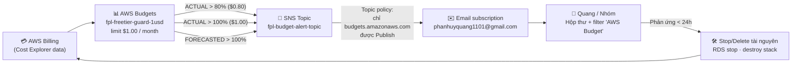

# 💸 P2-Q03 — AWS BUDGETS ALERT $1.00 GUARD (AWS FREE TIER) SETUP RUNBOOK

> **Task:** `P2-Q03` — *Risk Level 4 (Critical)* | **Owner:** Quang (DevOps & Cloud Infrastructure Lead)
> **Git Branch:** `feature/P2-Q03-aws-budget-guard`
> **Thư mục:** `infra/aws/` | **Files:** `budget_alert_setup.md` (tài liệu này), `budget_policy.json` (payload CLI)
> **Nguồn chuẩn:** [`docs/PROJECT_SSOT.md`](../../docs/PROJECT_SSOT.md) · [`docs/PROJECT_ROADMAP.md`](../../docs/PROJECT_ROADMAP.md) · [`docs/TODO.md`](../../docs/TODO.md) · [`docs/AI_GUIDELINES.md`](../../docs/AI_GUIDELINES.md)
>
> **Mục tiêu:** Dựng **hàng rào chi phí 2 lớp** trên tài khoản AWS `711695043505`: một **SNS topic** có email subscription của hòm thư nhóm + một **AWS Budget $1.00/month** phát cảnh báo tự động khi chi phí chạm **80% ($0.80)** và **100% ($1.00)**.
>
> ⚠️ **Đây là task BẮT BUỘC của toàn dự án:** theo cột *Verification Protocol* của `AI_GUIDELINES.md` (LEVEL 4), mọi task hạ tầng AWS khác (`P2-Q01` RDS, `P2-Q02` Security Group, `P2-Q04` S3, `P3-Q01..Q04`) **chỉ được phép triển khai sau khi task này ACTIVE**. Lý do: nếu có phát sinh phí ngoài ý muốn, cảnh báo phải nổ **trước khi** bill vượt $1.00.

---

## 🧭 MỤC LỤC

| # | Nội dung | # | Nội dung |
| :--- | :--- | :--- | :--- |
| 1 | Tóm tắt quyết định kỹ thuật | 9 | Kiểm chứng (Verification) — CLI / Console |
| 2 | Hiện trạng khảo sát & lỗ hổng đã vá | 10 | Kích hoạt subscription email (Pending → Confirmed) |
| 3 | Kiến trúc luồng cảnh báo | 11 | Test end-to-end sau khi Confirmed |
| 4 | Hạn mức Free Tier của Budgets & SNS | 12 | Troubleshooting |
| 5 | Nội dung `budget_policy.json` | 13 | Vận hành định kỳ (Cost Guardian routine) |
| 6 | Triển khai bằng AWS CLI | 14 | Rollback / Dọn dẹp (không để lại chi phí) |
| 7 | Phương án B: Tạo thủ công bằng Console | 15 | Ranh giới task & bàn giao |
| 8 | Topic policy bảo mật (least-privilege) | 16 | Checklist nghiệm thu (Acceptance Criteria) |

---

## ⚡ 1. TÓM TẮT QUYẾT ĐỊNH KỸ THUẬT

| Hạng mục | Giá trị | Lý do (Free Tier / Security) |
| :--- | :--- | :--- |
| **AWS Account** | `711695043505` (IAM user `quang-devops`) | Tài khoản chủ sở hữu đồ án (Quang). Không dùng root cho thao tác hằng ngày. |
| **Region** | `ap-southeast-1` (Singapore) | Chuẩn hoá theo `PROJECT_SSOT.md` (`AWS_REGION`), trùng region RDS/S3 sắp tạo. |
| **Budget name** | `fpl-freetier-guard-1usd` | Tên riêng, gắn Task ID trong tag → dễ đối soát, không đụng budget mặc định của AWS. |
| **Budget type** | `COST` · `MONTHLY` · limit **`1.0 USD`** | Đúng yêu cầu task: ngưỡng bảo vệ $1.00. Không dùng `RI_UTILIZATION`/`SAVINGS_PLANS`. |
| **Cost filter** | **Không đặt** (toàn bộ tài khoản) | Nếu lọc theo service thì chi phí phát sinh ở service khác sẽ **lọt lưới**. Guard phải nhìn toàn cục. |
| **Cost types** | Include tax / credit / refund / discount / recurring / upfront / subscription đều `true` | Cấu hình **thận trọng nhất**: tính cả credit & refund vào chi phí nhìn thấy → không bao giờ báo động muộn. |
| **Ngưỡng cảnh báo** | `ACTUAL > 80%` (**$0.80**) · `ACTUAL > 100%` (**$1.00**) · `FORECASTED > 100%` | Đúng AC; thêm ngưỡng **FORECASTED** để cảnh báo sớm khi dự báo cuối tháng vượt $1.00 (chưa cần chờ tới lúc tiền thực sự bị trừ). |
| **Notification channel** | **SNS topic** `fpl-budget-alert-topic` | Budgets **không tự gửi email** — bắt buộc phải có SNS topic + subscription làm kênh trung chuyển. |
| **Subscription** | `email` → `phanhuyquang1101@gmail.com` | Chỉ chấp nhận bằng link xác nhận (**double opt-in**) → không ai có thể subscribe hộ. |
| **Topic policy** | Chỉ `budgets.amazonaws.com` được `SNS:Publish`, có điều kiện `aws:SourceAccount` | **Least privilege**: không `Principal: "*"`, chặn service lạ bơm message vào topic. |
| **Số budget toàn tài khoản** | **2** (1 mặc định của AWS + 1 của task) | **2 budget đầu tiên MIỄN PHÍ**; từ budget thứ 3 trở đi mới bị tính $0.02/ngày → dừng ở 2. |
| **IaC** | AWS CLI + `budget_policy.json` (không thêm file `.tf`) | Tôn trọng giới hạn **2 file** của task; sẽ migrate sang Terraform ở Phase 3 (mục 15). |

> 📌 **Thứ tự thi hành:** `P2-Q03` (task này) → `P2-Q02` (Security Group RDS) → `P2-Q04` (S3). Việc làm trước `P2-Q02` là **chủ ý**: `P2-Q02` sẽ mở port 5432 theo IP whitelist — nếu cấu hình sai, nguy cơ phát sinh phí/truy cập lạ cao hơn nhiều so với một bucket S3 rỗng. Có guard $1.00 trước thì mọi rủi ro đều được báo động.

---

## 🔎 2. HIỆN TRẠNG KHẢO SÁT & LỖ HỔNG ĐÃ VÁ

Khảo sát **read-only** trước khi triển khai (ngày `2026-11-02`, region `ap-southeast-1`):

| Hạng mục | Kết quả khảo sát | Ý nghĩa |
| :--- | :--- | :--- |
| Identity | `arn:aws:iam::711695043505:user/quang-devops` (policy `AdministratorAccess`) | Đúng tài khoản của Quang, đủ quyền tạo SNS + Budgets. |
| AWS Budgets | **1 budget**: `My Zero-Spend Budget` (limit `$1.00`, notification `ACTUAL > $0.01`) | Budget này **KHÔNG có subscriber** → cảnh báo được tạo ra nhưng **không gửi tới ai**. |
| AWS SNS | **0 topic**, **0 subscription** | Không có kênh nhận tin ⇒ **mọi cảnh báo đều bị nuốt im lặng**. |
| Chi phí tháng hiện tại | `UnblendedCost = $0.00` | Tài khoản còn sạch, đúng thời điểm dựng guard. |

> 🚨 **Kết luận: tài khoản đang ở trạng thái "có cảnh báo nhưng không có người nghe".** Đây đúng là lỗ hổng mà `P2-Q03` phải vá. Sau task này:
> - Kênh nhận tin: **SNS topic + email subscription** (mới).
> - Bộ luật cảnh báo: **budget `fpl-freetier-guard-1usd`** với 3 ngưỡng (mới) — độc lập với budget mặc định của AWS (giữ nguyên, không xoá, không sửa).
>
> 💡 *Tuỳ chọn nâng cao (KHÔNG bật trong task này):* có thể gắn thêm subscriber SNS vào budget `My Zero-Spend Budget` để nhận cảnh báo ngay từ $0.01. Việc này bị **cố tình bỏ qua** nhằm tránh trùng lặp email rác và tránh sửa tài nguyên mặc định do AWS quản lý. Nếu Tech Lead yêu cầu, thực hiện ở task khác.

---

## 🏗️ 3. KIẾN TRÚC LUỒNG CẢNH BÁO



**Điểm kiểm soát (control points):**

1. **Budgets** chỉ là *cảm biến* — nó **không tự tắt** tài nguyên. Con người phải phản ứng (mục 13).
2. **SNS** là *kênh truyền* — nếu thiếu subscription đã confirm thì mọi ngưỡng đều vô nghĩa.
3. **Email** là *điểm cuối* — cần bật filter/label để không bị rơi vào spam (mục 12.1).

---

## 💰 4. HẠN MỨC FREE TIER CỦA BUDGETS & SNS

| Dịch vụ | Hạn mức Free Tier | Task này dùng | Kết luận |
| :--- | :--- | :--- | :--- |
| **AWS Budgets** | **2 budget đầu tiên miễn phí**; budget thứ 3 trở đi ~$0.02/ngày/budget | **2** (1 mặc định + 1 của task) | **$0.00** ✅ — *đây là lý do tuyệt đối không tạo budget thứ 3* |
| **AWS Budgets alerts** | Không giới hạn số notification trên mỗi budget | 3 notification | **$0.00** ✅ |
| **Amazon SNS** | ~1.000 email notification/tháng miễn phí (kèm 1M request publish) | Vài email/tháng | **$0.00** ✅ |
| **CloudWatch metrics** | Budgets không tạo custom metric tốn phí | 0 | **$0.00** ✅ |

**Hàng rào chi phí bổ sung của task:**

- **Hard rule:** nếu cần thêm budget → phải **xoá** một budget cũ trước (giữ tổng ≤ 2).
- **Không** bật Budget Actions, không bật *Cost Anomaly Detection* (dịch vụ riêng, có thể phát sinh phí).
- **Không** dùng SMS subscription (SMS tính phí ngoài hạn mức) → chỉ dùng **email**.
- Budget/SNS là tài nguyên **metadata**, không cấp phát compute ⇒ không có "phí ngủ" khi để chạy 24/7.

> ✅ **Kiểm tra nhanh số budget (chạy trước mỗi lần tạo mới):**
> ```bash
> aws budgets describe-budgets --account-id 711695043505 --region ap-southeast-1 \
>   --query 'length(Budgets)' --output text   # PHẢI <= 2
> ```

---

## 📄 5. NỘI DUNG `budget_policy.json`

File [`budget_policy.json`](budget_policy.json) là **payload chạy được thật** của lệnh
`aws budgets create-budget --cli-input-json`. Cấu trúc gồm 3 khối:

```json
{
  "AccountId": "711695043505",
  "Budget": { ... },
  "NotificationsWithSubscribers": [ ... ]
}
```

| Khối | Field | Giá trị trong file | Ghi chú |
| :--- | :--- | :--- | :--- |
| `AccountId` | — | `711695043505` | Account ID **không phải secret** (không chứa credential). |
| `Budget` | `BudgetName` | `fpl-freetier-guard-1usd` | Khoá định danh duy nhất trong account. |
| `Budget` | `BudgetType` / `TimeUnit` | `COST` / `MONTHLY` | Đo chi phí thực tế theo tháng dương lịch. |
| `Budget` | `BudgetLimit` | `{"Amount":"1.0","Unit":"USD"}` | **Ngưỡng bảo vệ $1.00** theo yêu cầu task. |
| `Budget` | `CostTypes` | Tất cả `true`, `UseBlended=false`, `UseAmortized=false` | Chế độ **thận trọng**: tính cả tax/credit/refund/discount. |
| `NotificationsWithSubscribers[0]` | `ACTUAL` `GREATER_THAN` `80.0` `PERCENTAGE` | → **$0.80** | Cảnh báo sớm (mốc 80% theo AC). |
| `NotificationsWithSubscribers[1]` | `ACTUAL` `GREATER_THAN` `100.0` `PERCENTAGE` | → **$1.00** | Chạm trần ngân sách (mốc 100% theo AC). |
| `NotificationsWithSubscribers[2]` | `FORECASTED` `GREATER_THAN` `100.0` `PERCENTAGE` | dự báo > $1.00 | Báo trước khi tiền thực sự vượt trần (early warning). |
| `Subscribers[]` | `SubscriptionType` / `Address` | `SNS` / `arn:aws:sns:ap-southeast-1:711695043505:fpl-budget-alert-topic` | Trỏ về topic ở mục 8. |

> 🧠 **Vì sao `Threshold` = `80`/`100` chứ không phải `0.8`/`1.0`?**
> Vì `ThresholdType = PERCENTAGE` → 80% của budget $1.00 = **$0.80**, 100% = **$1.00**. Hai cách viết tương đương về hành vi, nhưng dùng `PERCENTAGE` thì sau này nếu Tech Lead đổi `BudgetLimit` (ví dụ $5.00) thì ngưỡng **tự co giãn theo** mà không phải sửa 2 notification.
>
> 🧠 **Vì sao `GREATER_THAN` chứ không phải `GREATER_THAN_OR_EQUAL`?** Yêu cầu task là "**vượt** 80% / **vượt** 100%". Với `$1.00` và `GREATER_THAN`, cảnh báo nổ khi chi phí **> $0.80** và **> $1.00** — đúng ngữ nghĩa "vượt ngưỡng".

> ⚠️ `budget_policy.json` **chỉ tạo budget + notification**, KHÔNG tạo SNS topic/subscription.
> Topic + topic policy + subscription là 3 bước riêng ở mục 6 và 8 (AWS không hỗ trợ khai báo chúng trong payload `create-budget`).

---

## 🚀 6. TRIỂN KHAI BẰNG AWS CLI

### 6.1. Chuẩn bị (Prerequisites)

```bash
# AWS CLI v2 đã cài (đã kiểm tra: aws-cli/2.39.3)
aws --version

# Đúng tài khoản? -> phải ra arn:aws:iam::711695043505:user/quang-devops
aws sts get-caller-identity

# Cổng chi phí: phải <= 2 budget
aws budgets describe-budgets --account-id 711695043505 --region ap-southeast-1 \
  --query 'length(Budgets)' --output text
```

Đặt biến môi trường để mọi lệnh sau **không gõ sai ID**:

```bash
export AWS_ACCOUNT_ID=711695043505
export AWS_REGION_SG=ap-southeast-1
export BUDGET_TOPIC_ARN=arn:aws:sns:ap-southeast-1:711695043505:fpl-budget-alert-topic
export ALERT_EMAIL=phanhuyquang1101@gmail.com
export BUDGET_NAME=fpl-freetier-guard-1usd
```

### 6.2. Bước 1 — Tạo SNS topic

```bash
aws sns create-topic \
  --name fpl-budget-alert-topic \
  --region ap-southeast-1 \
  --tags Key=Project,Value=epl-fantasy-lineups Key=Owner,Value=Quang \
         Key=Task,Value=P2-Q03 Key=CostControl,Value=aws-free-tier
```

Kết quả thực tế (đã chạy):

```json
{ "TopicArn": "arn:aws:sns:ap-southeast-1:711695043505:fpl-budget-alert-topic" }
```

Đặt `DisplayName` để tiêu đề email dễ nhận biết (không bắt buộc nhưng nên làm):

```bash
aws sns set-topic-attributes \
  --topic-arn "$BUDGET_TOPIC_ARN" \
  --attribute-name DisplayName \
  --attribute-value 'FPL Free-Tier Budget Guard' \
  --region ap-southeast-1
```

### 6.3. Bước 2 — Gắn topic policy (bắt buộc, xem mục 8)

```bash
aws sns set-topic-attributes \
  --topic-arn "$BUDGET_TOPIC_ARN" \
  --attribute-name Policy \
  --attribute-value file://fpl_sns_topic_policy.json \
  --region ap-southeast-1
```

> 📎 Nội dung `fpl_sns_topic_policy.json` ở **mục 8.1**. Trên Windows + Git Bash, `file://` nhận **đường dẫn tương đối so với thư mục hiện tại** — an toàn nhất là `cd` tới thư mục chứa file rồi mới chạy lệnh.

### 6.4. Bước 3 — Đăng ký email nhận cảnh báo

```bash
aws sns subscribe \
  --topic-arn "$BUDGET_TOPIC_ARN" \
  --protocol email \
  --notification-endpoint "$ALERT_EMAIL" \
  --return-subscription-arn \
  --region ap-southeast-1
```

Kết quả thực tế (đã chạy):

```json
{
  "SubscriptionArn": "arn:aws:sns:ap-southeast-1:711695043505:fpl-budget-alert-topic:58680ef7-9c19-4d1b-8c15-9c10741a2c5e"
}
```

> 📬 Ngay sau lệnh này AWS gửi email **"AWS Notification - Subscription Confirmation"** tới `$ALERT_EMAIL`.
> Trạng thái lúc này vẫn là **`PendingConfirmation`** → **phải bấm link "Confirm subscription"** thì mới nhận được cảnh báo (mục 10).

### 6.5. Bước 4 — Tạo budget $1.00 + 3 notification

Chạy từ **thư mục gốc repo** (nơi có `infra/aws/budget_policy.json`):

```bash
aws budgets create-budget \
  --cli-input-json file://infra/aws/budget_policy.json \
  --region ap-southeast-1
```

- Thành công: **không có output**, exit code `0`.
- Nếu chạy lại lần 2 → lỗi `DuplicateRecordException` (budget đã tồn tại) ⇒ chuyển sang `update-budget` (mục 12.5).

### 6.6. Bước 5 — Gắn tag cho budget (khuyến nghị, phục vụ đối soát chi phí)

```bash
aws budgets create-budget-action ...   # KHÔNG dùng: budget action có thể phát sinh phí
# Chỉ tag metadata:
aws resourcegroupstaggingapi tag-resources \
  --resource-arn-list "arn:aws:budgets::711695043505:budget/$BUDGET_NAME" \
  --tags Project=epl-fantasy-lineups,Owner=Quang,Task=P2-Q03,CostControl=aws-free-tier \
  --region ap-southeast-1
```

> ℹ️ Nếu lệnh tag báo `ResourceNotFoundException` trên account mới, bỏ qua bước này — tag **không ảnh hưởng** chức năng cảnh báo. SNS topic đã được tag ở bước 1.

---

## 🖱️ 7. PHƯƠNG ÁN B: TẠO THỦ CÔNG BẰNG CONSOLE

Dùng khi CLI gặp sự cố hoặc khi cần demo trước lớp.

1. **SNS** → *Topics* → **Create topic** → Type `Standard`, Name `fpl-budget-alert-topic` → *Create topic*.
2. Trong topic vừa tạo → tab **Subscriptions** → **Create subscription** → Protocol `Email`, Endpoint `phanhuyquang1101@gmail.com` → *Create subscription*.
3. **Billing and Cost Management** → *Budgets* → **Create budget** → chọn **Use a template (simplified)** → template **Monthly cost budget**.
4. Điền:
   - *Budget name*: `fpl-freetier-guard-1usd`
   - *Enter your budgeted amount*: **`1.00` USD**
   - *Email recipients*: `phanhuyquang1101@gmail.com`
5. Bấm **Create budget**. Console sẽ **tự tạo/attach SNS topic + policy + 2 alert mặc định (85% actual, 100% forecasted)** — sau đó vào *Edit* để chỉnh về đúng 3 ngưỡng của mục 5:
   - Alert 1: `Actual` > `80` % of budgeted amount
   - Alert 2: `Actual` > `100` % of budgeted amount
   - Alert 3: `Forecasted` > `100` % of budgeted amount
6. Kiểm tra lại bằng CLI mục 9 (nguồn sự thật là API, không phải giao diện).

> ⚠️ **Cảnh báo:** nếu làm theo Console ở bước 3 bằng template, AWS có thể tạo **thêm 1 budget mới** → tổng có thể thành **3** ⇒ bắt đầu bị tính **$0.02/ngày**. Luôn kiểm tra `describe-budgets --query 'length(Budgets)'` sau khi thao tác bằng Console.

---

## 🔐 8. TOPIC POLICY BẢO MẬT (LEAST-PRIVILEGE)

### 8.1. Nội dung `fpl_sns_topic_policy.json`

```json
{
  "Version": "2012-10-17",
  "Id": "fpl-budget-alert-topic-policy",
  "Statement": [
    {
      "Sid": "AWSBudgetsSNSPublishingPermissions",
      "Effect": "Allow",
      "Principal": { "Service": "budgets.amazonaws.com" },
      "Action": "SNS:Publish",
      "Resource": "arn:aws:sns:ap-southeast-1:711695043505:fpl-budget-alert-topic",
      "Condition": {
        "StringEquals": { "aws:SourceAccount": "711695043505" }
      }
    },
    {
      "Sid": "AllowAccountOwnerFullControl",
      "Effect": "Allow",
      "Principal": { "AWS": "arn:aws:iam::711695043505:root" },
      "Action": [
        "SNS:GetTopicAttributes", "SNS:SetTopicAttributes", "SNS:AddPermission",
        "SNS:RemovePermission", "SNS:DeleteTopic", "SNS:Subscribe",
        "SNS:ListSubscriptionsByTopic", "SNS:Publish", "SNS:Receive"
      ],
      "Resource": "arn:aws:sns:ap-southeast-1:711695043505:fpl-budget-alert-topic"
    }
  ]
}
```

### 8.2. Giải thích từng statement

| Sid | Mục đích | Vì sao viết như vậy |
| :--- | :--- | :--- |
| `AWSBudgetsSNSPublishingPermissions` | Cho **duy nhất** service `budgets.amazonaws.com` quyền `SNS:Publish` vào topic | **BẮT BUỘC**: nếu thiếu statement này, budget tạo notification "thành công" nhưng message **bị SNS từ chối** ⇒ không bao giờ có email. Đây là lỗi phổ biến nhất khi tạo budget bằng CLI. |
| ↳ `Condition.aws:SourceAccount` | Chỉ chấp nhận message phát ra **từ chính account 711695043505** | Confused-deputy protection: chặn kịch bản một account khác lợi dụng `budgets.amazonaws.com` để bơm message vào topic của mình. |
| `AllowAccountOwnerFullControl` | Cho account root toàn quyền quản trị topic | Tránh **tự khoá mình**: khi thay policy mặc định, nếu không cấp quyền cho owner thì chính IAM user `quang-devops` cũng có thể mất quyền đọc/sửa/xoá topic (SNS yêu cầu **cả** IAM policy **và** resource policy cho same-account access). |

### 8.3. Những điều **TUYỆT ĐỐI KHÔNG** làm

| ❌ Không được | Lý do |
| :--- | :--- |
| `"Principal": "*"` hoặc `{"AWS": "*"}` cho `SNS:Publish` | Biến topic thành **public publisher** — bất kỳ ai trên Internet cũng spam được email của nhóm (email bombing, tốn hạn mức SNS). |
| `"Action": "SNS:*"` | Vi phạm least-privilege; Budgets chỉ cần `Publish`. |
| Bỏ `Resource` hoặc dùng `"*"` | Cho phép publish sang **mọi** topic trong account, không chỉ topic cảnh báo. |
| Thêm `Principal: {"Service": "cloudwatch.amazonaws.com"}` khi chưa dùng | Không cần thiết cho task này ⇒ bề mặt tấn công rộng hơn. |

### 8.4. Kiểm chứng policy đã áp dụng

```bash
aws sns get-topic-attributes \
  --topic-arn "$BUDGET_TOPIC_ARN" --region ap-southeast-1 \
  --query 'Attributes.Policy' --output text | python -m json.tool
```

**Kỳ vọng:** thấy `"Id": "fpl-budget-alert-topic-policy"` với đúng 2 statement trên (nếu thấy `__default_policy_ID` ⇒ **policy CHƯA được áp** — chạy lại mục 6.3).

**Test âm (bắt buộc phải PASS):** không tồn tại statement nào cho phép `*` publish vô điều kiện:

```bash
aws sns get-topic-attributes --topic-arn "$BUDGET_TOPIC_ARN" --region ap-southeast-1 \
  --query 'Attributes.Policy' --output text \
  | grep -c '"AWS":"\*"' || echo "AN_TOAN: khong co Principal wildcard"
```

---

## ✅ 9. KIỂM CHỨNG (VERIFICATION) — CLI / CONSOLE

> Toàn bộ output dưới đây là **kết quả thật**, chạy ngày `2026-11-02` trên account `711695043505`.

### V1 — `budget_policy.json` là JSON hợp lệ

```bash
python -m json.tool infra/aws/budget_policy.json > /dev/null && echo "JSON_VALID"
```
**Kết quả:** `JSON_VALID` ✅

### V2 — Budget tồn tại, đúng limit `$1.00`, đúng chu kỳ tháng

```bash
aws budgets describe-budget --account-id 711695043505 \
  --budget-name fpl-freetier-guard-1usd --region ap-southeast-1 \
  --query 'Budget.{Limit:BudgetLimit.Amount,Unit:BudgetLimit.Unit,Time:TimeUnit,Actual:CalculatedSpend.ActualSpend.Amount}' \
  --output json --no-cli-pager
```
**Kết quả thật:**

```json
{
    "Limit": "1.0",
    "Unit": "USD",
    "Time": "MONTHLY",
    "Actual": "0.0"
}
```
✅ Limit = **`1.0 USD`**, `TimeUnit = MONTHLY`, `BudgetType = COST` (kiểm tra `BudgetType` bằng `--query 'Budget.BudgetType' --output text` → `COST`).

### V3 — Đủ 3 ngưỡng cảnh báo (80% / 100% / forecast)

```bash
aws budgets describe-notifications-for-budget --account-id 711695043505 \
  --budget-name fpl-freetier-guard-1usd --region ap-southeast-1 \
  --query 'Notifications[].[NotificationType,ComparisonOperator,Threshold,ThresholdType,NotificationState]' \
  --output text
```
**Kết quả thật:**

```
ACTUAL      GREATER_THAN  100.0  None  OK
ACTUAL      GREATER_THAN   80.0  None  OK
FORECASTED  GREATER_THAN  100.0  None  OK
```
✅ Đủ **`80.0`** và **`100.0`** với `ACTUAL`.
ℹ️ Cột `ThresholdType = None` **không phải lỗi**: Budgets API **bỏ trống** field này khi giá trị là `PERCENTAGE` (giá trị mặc định) — chỉ trả về `ABSOLUTE_VALUE` khi bạn khai báo tuyệt đối. `NotificationState = OK` nghĩa là ngưỡng đang hoạt động, chưa bị "IN_ALARM".

### V4 — Notification có subscriber là SNS topic (không phải "cảnh báo rỗng")

```bash
aws budgets describe-subscribers-for-notification --account-id 711695043505 \
  --budget-name fpl-freetier-guard-1usd \
  --notification '{"NotificationType":"ACTUAL","ComparisonOperator":"GREATER_THAN","Threshold":80,"ThresholdType":"PERCENTAGE"}' \
  --region ap-southeast-1 --query 'Subscribers' --output json
```
**Kết quả thật:**

```json
[ { "SubscriptionType": "SNS",
    "Address": "arn:aws:sns:ap-southeast-1:711695043505:fpl-budget-alert-topic" } ]
```
✅ Đây là bước **phân biệt** với budget mặc định `My Zero-Spend Budget` (có notification nhưng subscriber rỗng).

### V5 — SNS topic + subscription

```bash
aws sns list-subscriptions-by-topic --topic-arn "$BUDGET_TOPIC_ARN" \
  --region ap-southeast-1 --query 'Subscriptions[].[Protocol,Endpoint,SubscriptionArn]' --output text
```
**Kết quả thật (ngay sau khi tạo):**

```
email   phanhuyquang1101@gmail.com   PendingConfirmation
```
⚠️ `PendingConfirmation` = **chưa nhận được cảnh báo** → phải làm mục 10. Sau khi confirm sẽ thành ARN đầy đủ (`...:58680ef7-9c19-4d1b-8c15-9c10741a2c5e`).

### V6 — Topic policy đúng (xem mục 8.4) — `Id = fpl-budget-alert-topic-policy`

### V7 — Không vượt hạn mức 2 budget miễn phí

```bash
aws budgets describe-budgets --account-id 711695043505 --region ap-southeast-1 \
  --query 'length(Budgets)' --output text
```
**Kết quả thật:** `2` ✅ (`My Zero-Spend Budget`, `fpl-freetier-guard-1usd`)

### V8 — Chi phí hiện tại vẫn $0.00

```bash
aws ce get-cost-and-usage --time-period Start=2026-11-01,End=2026-12-01 \
  --granularity MONTHLY --metrics UnblendedCost --region us-east-1 \
  --query 'ResultsByTime[0].Total.UnblendedCost.Amount' --output text
```
**Kết quả thật:** `0` ✅

### 9.1. Kiểm tra trên Console (bằng chứng chụp màn hình để nộp đồ án)

| Màn hình | Đường dẫn | Cần thấy gì |
| :--- | :--- | :--- |
| Budgets | *Billing and Cost Management* → **Budgets** | `fpl-freetier-guard-1usd` · **Budgeted amount $1.00** · *Current* `$0.00` |
| Alert | Bấm tên budget → mục **Alerts** | 2 dòng `Actual 80%`, `Actual 100%` + 1 dòng `Forecasted 100%`, cột *Recipients* có **SNS topic** |
| SNS | **SNS** → *Topics* → `fpl-budget-alert-topic` → *Subscriptions* | `phanhuyquang1101@gmail.com` · Status **Confirmed** (sau mục 10) |
| Hộp thư | Gmail | Email **"AWS Notification - Subscription Confirmation"** + email cảnh báo khi vượt ngưỡng |

---

## 📬 10. KÍCH HOẠT SUBSCRIPTION EMAIL (PENDING → CONFIRMED)

Đây là bước **bắt buộc do con người thực hiện** (AWS chống spam bằng double opt-in). AI/CLI **không thể** xác nhận thay.

1. Mở hộp thư `phanhuyquang1101@gmail.com`.
2. Tìm email:
   - **From:** `no-reply@sns.amazonaws.com`
   - **Subject:** `AWS Notification - Subscription Confirmation`
3. Bấm **Confirm subscription** trong email → trình duyệt mở trang `Subscription confirmed!`.
4. Kiểm tra lại bằng CLI:

```bash
aws sns list-subscriptions-by-topic --topic-arn "$BUDGET_TOPIC_ARN" \
  --region ap-southeast-1 --query 'Subscriptions[].[Endpoint,SubscriptionArn]' --output text
```

**Kỳ vọng:** cột thứ 2 là ARN đầy đủ (không còn `PendingConfirmation`) ✅

**Nếu không thấy email:** xem mục 12.1 (spam/quarantine, gửi lại, đổi email).
> ⏳ Subscription chưa confirm thì **mọi cảnh báo $0.80/$1.00 đều bị SNS loại bỏ** — budget vẫn "xanh" nhưng bạn không nhận được gì. Đừng bỏ qua bước này.

---

## 🧪 11. TEST END-TO-END SAU KHI CONFIRMED

### 11.1. Test kênh SNS → Email (nhanh, miễn phí, làm ngay)

```bash
aws sns publish \
  --topic-arn "$BUDGET_TOPIC_ARN" \
  --subject "[P2-Q03] Test kenh canh bao ngan sach" \
  --message "Neu ban nhan duoc email nay, kenh SNS -> Email da hoat dong. Budget fpl-freetier-guard-1usd se gui canh bao qua kenh nay." \
  --region ap-southeast-1
```

**Kỳ vọng:** nhận email trong **< 1 phút** (email đã confirm). Nếu có `MessageId` trả về mà **không** thấy mail ⇒ lỗi ở subscription/email, xem mục 12.1.

### 11.2. Test luồng Budgets → SNS (tuỳ chọn, nâng cao ⚠️)

AWS Budgets **không có nút "Send test alert"**, và việc chờ chi phí thật vượt $0.80 là không khả thi trong môi trường $0.00. Thủ thuật kiểm thử có kiểm soát (chỉ làm khi Tech Lead đồng ý):

```bash
# 1) Tạm đổi ngưỡng 80% thành ABSOLUTE_VALUE 0.0 với GREATER_THAN_OR_EQUAL -> 0.0 >= 0.0 = TRUE
aws budgets update-notification --account-id 711695043505 \
  --budget-name fpl-freetier-guard-1usd \
  --old-notification '{"NotificationType":"ACTUAL","ComparisonOperator":"GREATER_THAN","Threshold":80,"ThresholdType":"PERCENTAGE"}' \
  --new-notification '{"NotificationType":"ACTUAL","ComparisonOperator":"GREATER_THAN_OR_EQUAL","Threshold":0,"ThresholdType":"ABSOLUTE_VALUE"}' \
  --region ap-southeast-1

# 2) Chờ chu kỳ làm mới dữ liệu của Budgets (tới vài giờ, tối đa ~24h) rồi xem state
aws budgets describe-notifications-for-budget --account-id 711695043505 \
  --budget-name fpl-freetier-guard-1usd --region ap-southeast-1 \
  --query 'Notifications[].NotificationState' --output text   # ky vong: IN_ALARM

# 3) BẮT BUỘC revert về cấu hình chuẩn của task
aws budgets update-notification --account-id 711695043505 \
  --budget-name fpl-freetier-guard-1usd \
  --old-notification '{"NotificationType":"ACTUAL","ComparisonOperator":"GREATER_THAN_OR_EQUAL","Threshold":0,"ThresholdType":"ABSOLUTE_VALUE"}' \
  --new-notification '{"NotificationType":"ACTUAL","ComparisonOperator":"GREATER_THAN","Threshold":80,"ThresholdType":"PERCENTAGE"}' \
  --region ap-southeast-1
```

> ⚠️ **Rủi ro:** nếu quên bước 3, budget sẽ gửi cảnh báo sai lệch mãi mãi. Luôn chạy lại **V3 (mục 9)** sau khi test để xác nhận đã về đúng `ACTUAL GREATER_THAN 80.0`.
> ✅ **Khuyến nghị:** chỉ chạy **11.1** cho nghiệm thu; dùng 11.2 khi cần chứng minh end-to-end trước hội đồng.

---

## 🔧 12. TROUBLESHOOTING

### 12.1. Không nhận được email "Subscription Confirmation"

| Nguyên nhân | Cách xử lý |
| :--- | :--- |
| Email vào **Spam / Promotions / Quarantine** | Tìm `no-reply@sns.amazonaws.com`, bấm **Report not spam**, tạo filter gắn label `AWS-Budget` |
| Gõ sai địa chỉ | Kiểm tra `aws sns list-subscriptions-by-topic ... --query 'Subscriptions[].Endpoint'` |
| Subscription **quá 3 ngày không confirm** → AWS tự xoá | Tạo lại: `aws sns subscribe --topic-arn "$BUDGET_TOPIC_ARN" --protocol email --notification-endpoint "$ALERT_EMAIL" --region ap-southeast-1` |
| Đã confirm nhưng vẫn `PendingConfirmation` | Xoá subscription cũ rồi subscribe lại để AWS gửi email mới: `aws sns unsubscribe --subscription-arn <ARN> --region ap-southeast-1` |
| Hộp thư nhóm chặn email ngoài | Dùng email dự phòng (Gmail cá nhân) và subscribe thêm — nhiều subscriber trên một topic là hợp lệ |

### 12.2. Budget tạo "thành công" nhưng không bao giờ gửi cảnh báo

Thứ tự kiểm tra **từ nguyên nhân phổ biến nhất**:

1. **Subscription chưa Confirmed** → mục 10.
2. **Topic policy còn là default** (`__default_policy_ID`) hoặc thiếu `budgets.amazonaws.com` → chạy mục 8.4 ⇒ nếu sai, áp lại mục 6.3. *(Đây là lỗi số 1 khi tạo budget bằng CLI.)*
3. **Notification không có subscriber** → chạy V4 (mục 9).
4. **Budgets chưa refresh dữ liệu** → AWS Budgets làm mới tối đa **3 lần/ngày**; tài khoản mới có thể mất **tới 24h** mới có dữ liệu chi phí đầu tiên ⇒ cảnh báo không thể nổ trước khi có dữ liệu.
5. **Ngưỡng chưa thực sự bị vượt** → xem `CalculatedSpend.ActualSpend` trong V2.

### 12.3. `DuplicateRecordException` khi chạy lại `create-budget`

Budget đã tồn tại — dùng update thay vì create:

```bash
aws budgets update-budget --account-id 711695043505 \
  --new-budget '{"BudgetName":"fpl-freetier-guard-1usd","BudgetType":"COST","TimeUnit":"MONTHLY","BudgetLimit":{"Amount":"1.0","Unit":"USD"}}' \
  --region ap-southeast-1
```

### 12.4. Sai/thay đổi ngưỡng cảnh báo

```bash
# Đổi 80% -> 90% (ví dụ) rồi đổi lại
aws budgets update-notification --account-id 711695043505 \
  --budget-name fpl-freetier-guard-1usd \
  --old-notification '{"NotificationType":"ACTUAL","ComparisonOperator":"GREATER_THAN","Threshold":80,"ThresholdType":"PERCENTAGE"}' \
  --new-notification '{"NotificationType":"ACTUAL","ComparisonOperator":"GREATER_THAN","Threshold":90,"ThresholdType":"PERCENTAGE"}' \
  --region ap-southeast-1
```
Sau **mọi** thay đổi, chạy lại **V3** và cập nhật `budget_policy.json` cho khớp (file JSON là **nguồn sự thật**, không để lệch với AWS).

### 12.5. Vẫn nhận cảnh báo dù chi phí $0.00

Đó là ngưỡng **`FORECASTED`**: Budgets dự báo chi phí cuối tháng dựa trên tốc độ phát sinh. Nếu bạn vừa tạo tài nguyên trả phí trong vài giờ, forecast có thể vượt $1.00 dù actual còn thấp → **đây là cảnh báo đúng, không phải lỗi**. Hãy kiểm tra ngay tài nguyên nào đang chạy (mục 13).

### 12.6. Budget Action / tự động hoá — KHÔNG dùng trong task này

AWS Budgets hỗ trợ *Budget Actions* (tự gắn IAM policy, stop instance khi vượt ngưỡng), nhưng:
- Có thể **phát sinh phí** và có quyền hạn rất lớn (thay đổi hạ tầng tự động).
- Không thuộc phạm vi AC của `P2-Q03`.
⇒ Nếu muốn dùng, phải mở task mới + Tech Lead review (LEVEL 4).

---

## 🔁 13. VẬN HÀNH ĐỊNH KỲ (COST GUARDIAN ROUTINE)

| Tần suất | Việc phải làm | Lệnh / Màn hình |
| :--- | :--- | :--- |
| **Hằng tuần (T2)** | Đối soát chi phí tháng | `aws ce get-cost-and-usage --time-period Start=<đầu tháng>,End=<cuối tháng> --granularity MONTHLY --metrics UnblendedCost` |
| **Hằng tuần** | Kiểm tra còn trong Free Tier | *Billing* → **Free Tier** (RDS 750h, S3 5GB, … phải < 100%) |
| **Hằng tuần** | Subscription còn `Confirmed` | `aws sns list-subscriptions-by-topic --topic-arn "$BUDGET_TOPIC_ARN" --query 'Subscriptions[].SubscriptionArn' --output text` |
| **Hằng tháng** | Số budget ≤ 2 | `aws budgets describe-budgets --account-id 711695043505 --query 'length(Budgets)' --output text` |
| **Khi không dùng ≥ 1 tuần** | Stop RDS | `aws rds stop-db-instance --db-instance-identifier fpl-fantasy-db --region ap-southeast-1` |
| **Trước deadline đồ án** | Chụp bằng chứng (mục 9.1) | Console + hộp thư |
| **Sau mỗi task AWS mới** | Kiểm tra budget vẫn $1.00 & không có budget thứ 3 | V7 |

**Khi nhận email vượt ngưỡng — quy trình phản ứng 4 bước (trong 24h):**

1. **Xác định** nguồn phát sinh: *Billing* → **Cost Explorer** → group by *Service* (region `us-east-1` cho Cost Explorer).
2. **Dừng** tài nguyên không cần: RDS `stop-db-instance` / `terraform destroy` (`infra/aws/rds_setup.md` mục 11).
3. **Kiểm chứng** đã dừng: `describe-db-instances` → `DBInstanceStatus = stopped`; EC2 → `stopped` (không tính phí compute, **vẫn tính** phí EBS).
4. **Ghi nhận** sự cố vào báo cáo Phase 3 (`P3-Q04` — `docs/COST_REPORT.md`).

> 🧠 **Nguyên tắc vàng:** cảnh báo $1.00 **không thay thế** việc giữ hạ tầng trong Free Tier. Nó chỉ là **lưới an toàn cuối** khi mọi thứ khác sai.

---

## 🧹 14. ROLLBACK / DỌN DẸP (KHÔNG ĐỂ LẠI CHI PHÍ)

Thứ tự **bắt buộc**: xoá budget trước (nếu xoá topic trước, budget sẽ trỏ tới topic chết và sinh notification lỗi).

```bash
# 1) Xoá budget (kèm toàn bộ notification)
aws budgets delete-budget --account-id 711695043505 \
  --budget-name fpl-freetier-guard-1usd --region ap-southeast-1

# 2) Xoá email subscription
aws sns unsubscribe \
  --subscription-arn "arn:aws:sns:ap-southeast-1:711695043505:fpl-budget-alert-topic:58680ef7-9c19-4d1b-8c15-9c10741a2c5e" \
  --region ap-southeast-1

# 3) Xoá SNS topic
aws sns delete-topic --topic-arn "$BUDGET_TOPIC_ARN" --region ap-southeast-1

# 4) Kiểm chứng đã sạch
aws budgets describe-budgets --account-id 711695043505 --region ap-southeast-1 --query 'Budgets[].BudgetName' --output text
aws sns list-topics --region ap-southeast-1 --query 'Topics[].TopicArn' --output text
```

> 🚫 **KHÔNG xoá budget `My Zero-Spend Budget`** (budget mặc định của AWS) trừ khi có lý do rõ ràng — nó vô hại và giúp giữ số budget ≤ 2.
>
> ⚠️ Sau khi rollback, **tài khoản trở lại trạng thái không có cảnh báo** ⇒ chỉ rollback khi kết thúc đồ án hoặc khi đổi sang Terraform quản lý (mục 15).

---

## 🚧 15. RANH GIỚI TASK & BÀN GIAO

### 15.1. Tuân thủ `AI_GUIDELINES.md`

| Quy tắc | Cách task này tuân thủ |
| :--- | :--- |
| **Strict scope boundary** | Chỉ tạo file trong `infra/aws/`. **Không** sửa `infra/aws/rds_setup.md`, `terraform_rds.tf` của `P2-Q01`; **không** mở port, không tạo Security Group (việc của `P2-Q02`); không đụng `docs/`, `backend/`, `frontend/`. |
| **Max 5 new files** | **2/5** file: `budget_alert_setup.md`, `budget_policy.json` (đúng danh sách TODO.md quy định). |
| **No hardcoded secret** | Không có access key/mật khẩu. `AccountId`, ARN, email nhóm là **metadata công khai nội bộ**, không phải secret. |
| **Cost & Security first** | Guard $1.00 ACTIVE trước khi làm bất kỳ tài nguyên AWS nào khác; topic policy least-privilege; không dùng SMS/Budget Action; giữ ≤ 2 budget. |
| **No unauthorized commit** | Không chạy `git commit`/`git push`. Chờ Quang review `git diff` và ra lệnh. |

### 15.2. Vì sao chưa có file `.tf`?

- Yêu cầu task giới hạn **2 file** (`budget_alert_setup.md`, `budget_policy.json`) ⇒ không thể thêm `terraform_budget.tf` trong task này.
- Hạ tầng đã được **tự động hoá 100% bằng CLI idempotent** + payload JSON trong repo ⇒ vẫn tái lập được (mục 6).
- **Kế hoạch migrate (task tương lai, đề xuất ghi vào `P3-Q01`/`P2-Q05`):** chuyển sang Terraform với 2 resource `aws_sns_topic` + `aws_budgets_budget` (provider `hashicorp/aws ~> 5.60`, dùng chung `locals.common_tags` của `terraform_rds.tf`), sau đó **import** tài nguyên hiện có thay vì tạo lại:
  ```bash
  terraform import aws_sns_topic.budget_alerts arn:aws:sns:ap-southeast-1:711695043505:fpl-budget-alert-topic
  terraform import aws_budgets_budget.freetier_guard 711695043505:fpl-freetier-guard-1usd
  ```

### 15.3. Bàn giao cho các task sau

| Task | Nhận được gì từ `P2-Q03` |
| :--- | :--- |
| `P2-Q02` (Security Group) | Được phép triển khai (điều kiện tiên quyết đã đạt: guard ACTIVE) |
| `P2-Q04` (S3) | Guard sẵn sàng bắt chi phí S3/CloudFront nếu vượt Free Tier |
| `P3-Q01..Q03` | Mọi deploy đều có cảnh báo; dùng lại `$BUDGET_TOPIC_ARN` nếu cần thêm kênh cảnh báo khác |
| `P3-Q04` (Cost report) | Bằng chứng: budget `$1.00` + 3 alert + email subscription đã confirm |

---

## ✅ 16. CHECKLIST NGHIỆM THU (ACCEPTANCE CRITERIA)

### 16.1. Tiêu chí bắt buộc của task

| # | Tiêu chí | Trạng thái | Bằng chứng |
| :--- | :--- | :--- | :--- |
| **AC-1** | Budget Alert kích hoạt thành công trên AWS Budgets ở mức **$1.00** | ✅ **ĐẠT** | `fpl-freetier-guard-1usd` · `BudgetLimit = 1.0 USD` · `MONTHLY` · `COST` (V2) |
| **AC-2** | Cảnh báo cấu hình ở **80% ($0.80)** và **100% ($1.00)** | ✅ **ĐẠT** | 3 notification: `ACTUAL > 80%`, `ACTUAL > 100%`, `FORECASTED > 100%` (V3) |
| **AC-3** | Notification trỏ tới **SNS topic** có subscriber email nhóm | ✅ **ĐẠT** | `Subscribers = SNS arn:...:fpl-budget-alert-topic` (V4) · subscription email `phanhuyquang1101@gmail.com` (V5) |
| **AC-4** | Topic policy an toàn (chỉ `budgets.amazonaws.com` publish, không wildcard) | ✅ **ĐẠT** | `Id = fpl-budget-alert-topic-policy` (mục 8.4) |
| **AC-5** | Chi phí duy trì **$0.00** (Free Tier) | ✅ **ĐẠT** | 2 budget (hạn mức free) · 0 SMS · `UnblendedCost = 0` (V7, V8) |
| **AC-6** | **Nhận email xác nhận subscription từ AWS SNS** | 🟡 **CHỜ QUANG** | Email `AWS Notification - Subscription Confirmation` đã được gửi tới `phanhuyquang1101@gmail.com` — **cần bấm Confirm** (mục 10). Bước này **không thể tự động hoá** (double opt-in của AWS). |

### 16.2. Checklist dành cho Quang (DevOps Guardian)

- [ ] Bấm **Confirm subscription** trong email SNS (mục 10) → chạy lại V5 thấy ARN đầy đủ.
- [ ] Chạy **11.1** (`sns publish` test) và xác nhận nhận được email test.
- [ ] Chụp màn hình 4 bằng chứng ở mục 9.1 (Budgets / Alerts / SNS Subscriptions / hộp thư).
- [ ] Mở `docs/TODO.md` → tích **`[x]`** vào `P2-Q03`.
- [ ] `git diff` review 2 file mới trước khi cho phép commit.
- [ ] Tạo label/filter `AWS-Budget` trong Gmail để cảnh báo không bị chôn.
- [ ] Ghi nhớ: **không** tạo budget thứ 3.

### 16.3. Lệnh kiểm tra nhanh "tất cả trong một"

```bash
# 0) Đúng tài khoản?
aws sts get-caller-identity --query Arn --output text

# 1) Budget + limit
aws budgets describe-budget --account-id 711695043505 \
  --budget-name fpl-freetier-guard-1usd --region ap-southeast-1 \
  --query 'Budget.{Limit:BudgetLimit.Amount,Unit:BudgetLimit.Unit,Time:TimeUnit,Actual:CalculatedSpend.ActualSpend.Amount}' \
  --output json --no-cli-pager

# 2) Các ngưỡng cảnh báo
aws budgets describe-notifications-for-budget --account-id 711695043505 \
  --budget-name fpl-freetier-guard-1usd --region ap-southeast-1 \
  --query 'Notifications[].[NotificationType,Threshold,NotificationState]' --output text --no-cli-pager

# 3) Subscription đã confirm chưa?
aws sns list-subscriptions-by-topic \
  --topic-arn arn:aws:sns:ap-southeast-1:711695043505:fpl-budget-alert-topic \
  --region ap-southeast-1 --query 'Subscriptions[].[Endpoint,SubscriptionArn]' --output text --no-cli-pager

# 4) Số budget (<= 2) + chi phí tháng
aws budgets describe-budgets --account-id 711695043505 --region ap-southeast-1 \
  --query 'length(Budgets)' --output text --no-cli-pager
aws ce get-cost-and-usage --time-period Start=2026-11-01,End=2026-12-01 \
  --granularity MONTHLY --metrics UnblendedCost --region us-east-1 \
  --query 'ResultsByTime[0].Total.UnblendedCost.Amount' --output text --no-cli-pager
```

---

## 📚 PHỤ LỤC — LIÊN KẾT NHANH

| Tài nguyên | Đường dẫn |
| :--- | :--- |
| Payload CLI của task này | [`infra/aws/budget_policy.json`](budget_policy.json) |
| Runbook RDS (bị chặn bởi task này) | [`infra/aws/rds_setup.md`](rds_setup.md) |
| Trạng thái task | [`docs/TODO.md`](../../docs/TODO.md) — mục **P2-Q03** |
| Hợp đồng dữ liệu / tech stack | [`docs/PROJECT_SSOT.md`](../../docs/PROJECT_SSOT.md) |
| Quy chuẩn AI & ma trận rủi ro | [`docs/AI_GUIDELINES.md`](../../docs/AI_GUIDELINES.md) |
| AWS Budgets — create-budget API | <https://docs.aws.amazon.com/awsaccountbilling/latest/aboutv2/budgets-managing-costs.html> |
| AWS Budgets notifications & SNS policy | <https://docs.aws.amazon.com/awsaccountbilling/latest/aboutv2/budgets-sns-policy.html> |
| AWS Budgets pricing (2 budget miễn phí) | <https://aws.amazon.com/aws-cost-management/aws-budgets/pricing/> |
| Amazon SNS pricing / Free Tier | <https://aws.amazon.com/sns/pricing/> |

---

> ✍️ **Ghi chú bảo trì:** mọi thay đổi về `BudgetLimit`, danh sách ngưỡng, hoặc `Principal` trong topic policy đều là **thay đổi Level 4** → phải qua review của Tech Lead, cập nhật **đồng thời** `budget_policy.json` và tài liệu này để tránh lệch giữa "nguồn sự thật trong repo" và trạng thái thật trên AWS.

